## 3. 로그인과 화면 구성

### 3-1. 회원가입과 로그인

#### 로그인 화면

`http://localhost:8080/` 또는 `/login` 으로 접속하면 로그인 화면이 표시됩니다.

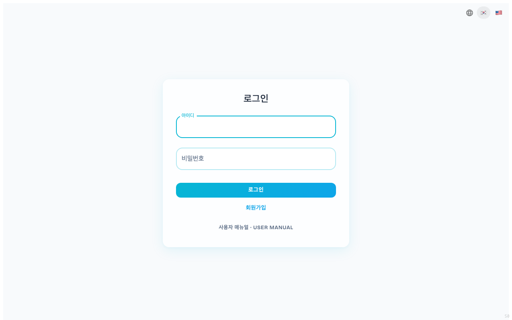

기존 계정이 있다면 **아이디·비밀번호**를 입력하고 **[로그인]** 버튼을 클릭합니다. 처음 사용한다면 하단의 **[회원가입]** 버튼을 클릭해서 계정을 만듭니다.

> 💡 로그인 화면 하단의 **사용자 매뉴얼** 링크로 로그인 전에도 본 매뉴얼(한/영)을 열람할 수 있습니다.

#### 회원가입 폼

회원가입 모드로 전환되면 다음 5개 필드가 표시됩니다.

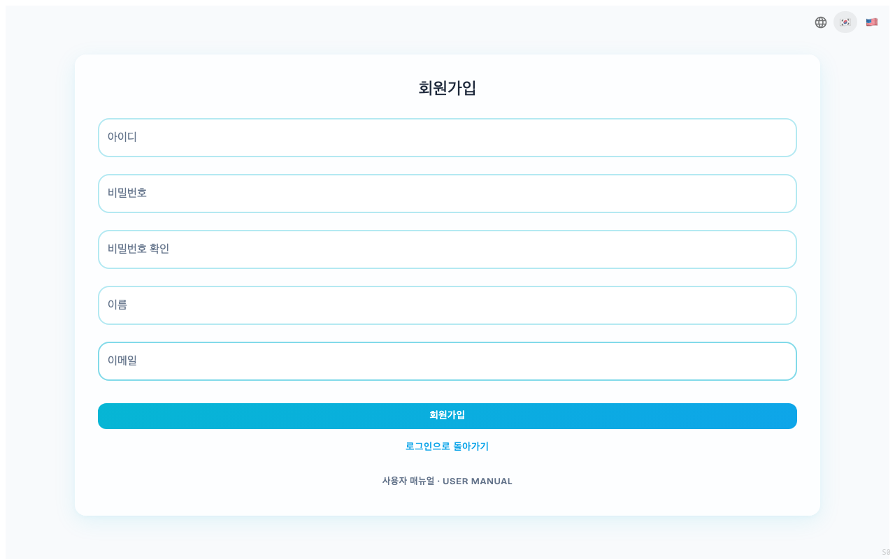

| 필드 | 설명 |
|---|---|
| 아이디 | 로그인용 식별자 (영문/숫자 권장) |
| 비밀번호 | 8자 이상 권장 |
| 비밀번호 확인 | 위와 동일하게 다시 입력 |
| 이름 | 화면에 표시될 사용자 이름 |
| 이메일 | 인증·알림 발송용 이메일 주소 |

모든 필드를 채운 모습입니다.

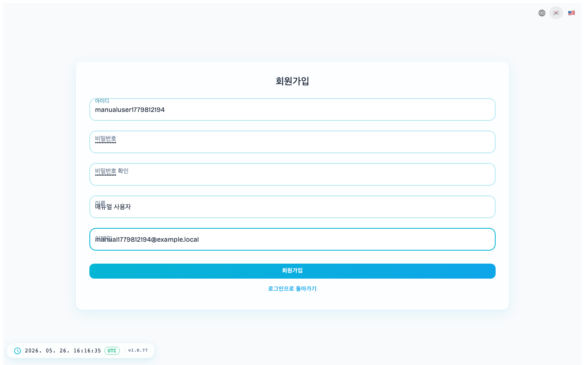

**[회원가입]** 버튼을 누르면 계정이 등록되고, 자동으로 로그인 화면으로 돌아옵니다(성공 안내 표시).

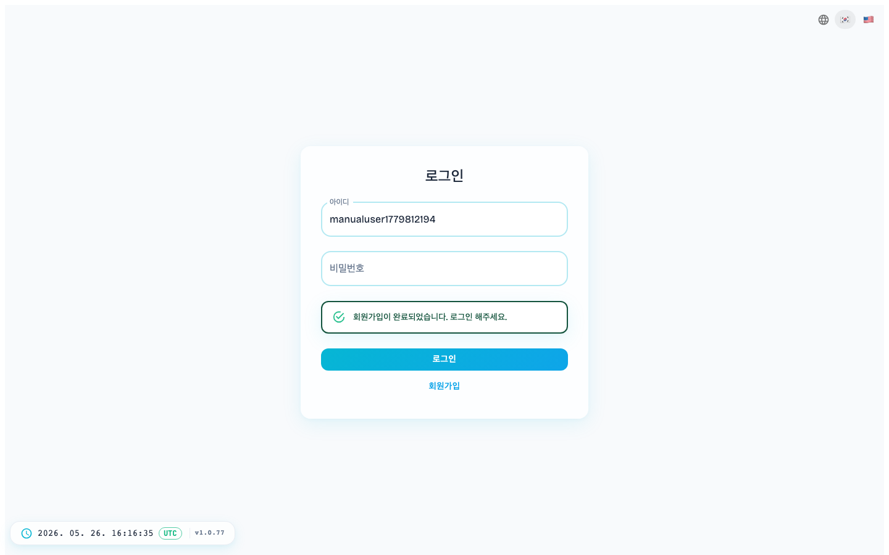

> ⚠️ **에러 메시지가 보이면** — `Failed to fetch` 같은 네트워크 오류는 서비스 접속 주소 설정 문제일 수 있습니다. 운영 담당자에게 문의하세요 (상세는 [`DOCKER_SETUP.md`](../../deployment/DOCKER_SETUP.md) 10-2절 참고).

#### 로그인

방금 만든 계정으로 로그인합니다.

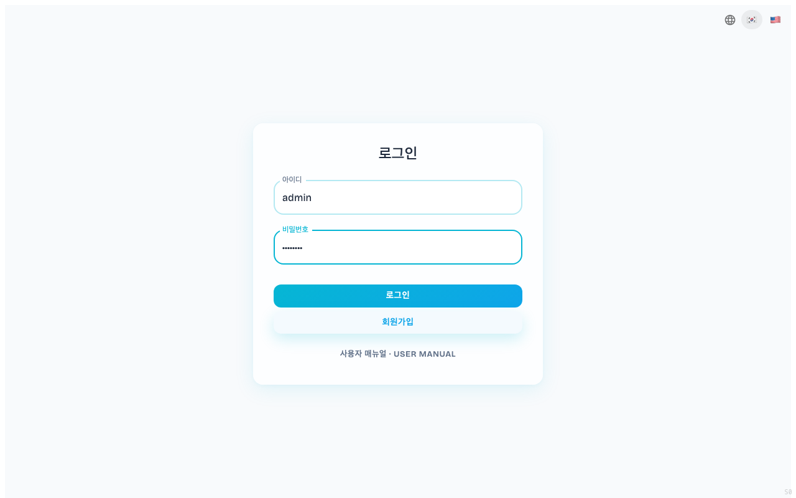

성공하면 **프로젝트 관리** 화면으로 이동합니다.

### 3-2. 화면 구성과 헤더

프로젝트에 진입하면 상단 헤더 + 좌측 트리 + 우측 본문의 3분할 레이아웃이 표시됩니다. 첫 화면은 프로젝트 대시보드가 기본으로 열리며, 전사 대시보드는 `/dashboard` 로 별도 접근합니다.

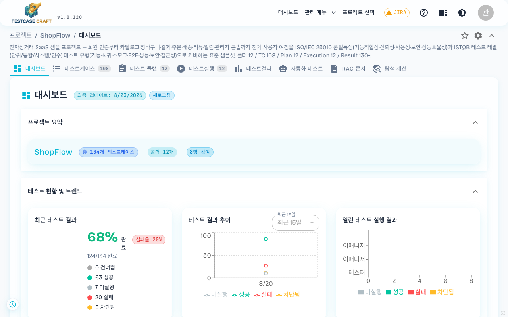

> **2026-05-29 변경**: 폼의 **필드 표시 토글**·**입력 모드 선택** 등 화면별 사용자 설정은 서버에 사용자별로 저장됩니다. 다른 PC 에서 로그인해도 같은 설정이 그대로 유지됩니다.

#### 헤더 구성

헤더는 좌측 로고와 우측 도구 모음으로 구성됩니다 (왼쪽부터 순서대로):

| 영역 | 설명 |
|---|---|
| 좌측 로고 `TESTCASE CRAFT` (+ 버전) | 클릭 시 프로젝트 목록으로 이동 |
| **[프로젝트 선택]** | 참여 중인 다른 프로젝트로 빠르게 전환 (드롭다운) |
| `JIRA` 배지 | 연동 상태 표시 — 연결됨이면 초록 `✓ JIRA`, 미설정이면 노란 `⚠ JIRA`. 클릭하면 연동 상태·설정으로 이동 |
| **☆** (별 모양 아이콘) | 현재 프로젝트의 **북마크**(즐겨찾기) 화면으로 이동 (자세한 내용은 [6-7. 북마크 & 즐겨찾기](06_테스트케이스_작성.md#6-7-북마크--즐겨찾기)) |
| **?** (동그라미 물음표 아이콘) | **사용자 매뉴얼**(한/영)을 새 탭으로 엽니다 |
| ◐ (반달 모양 아이콘) | 다크/라이트 모드 전환 |
| 사용자 아바타 (이니셜) | 클릭 시 프로필 / 사용자 매뉴얼 / 로그아웃 메뉴 |

> 관리자(ADMIN) 계정에는 좌측에 **[대시보드] · [관리 메뉴 ▾]** 가 추가로 표시됩니다 (자세한 내용은 [17-1. 관리자 메뉴 진입](17_시스템관리_ADMIN.md#17-1-관리자-메뉴-진입)).

헤더 **바로 아래**에는 현재 위치를 보여주는 **브레드크럼**(`프로젝트 / 샘플 프로젝트 / 대시보드`)과, 프로젝트 내 영역을 전환하는 **탭바**(대시보드 / 테스트케이스 / 테스트 플랜 / 테스트실행 / 테스트결과 / 자동화 테스트 / RAG 문서 / 탐색 세션 / 요구사항)가 표시됩니다. 테스트케이스·테스트 플랜·테스트실행 탭 라벨 옆에는 각각의 개수 배지가 함께 표시됩니다.

> **2026-06-06 변경**: **테스트케이스 / 테스트 플랜 / 테스트실행** 탭 라벨 옆에 각각의 개수를 보여주는 배지가 표시됩니다.

> **2026-07-31 변경**: 프로젝트 안의 영역 이동을 **가로 탭**과 **좌측 메뉴** 중에서 고를 수 있습니다. 고르는 곳은 프로필 → 테마 설정 → `메뉴 구조` 이고([15-4. 테마 설정](15_내계정_설정.md#15-4-테마-설정)), 기본값은 지금까지의 가로 탭입니다. 상단 바의 전환 아이콘으로도 바로 바꿉니다.

좌측 메뉴를 고르면 영역이 화면 왼쪽에 세로로 놓입니다. 항목과 개수 배지는 가로 탭과 같습니다.

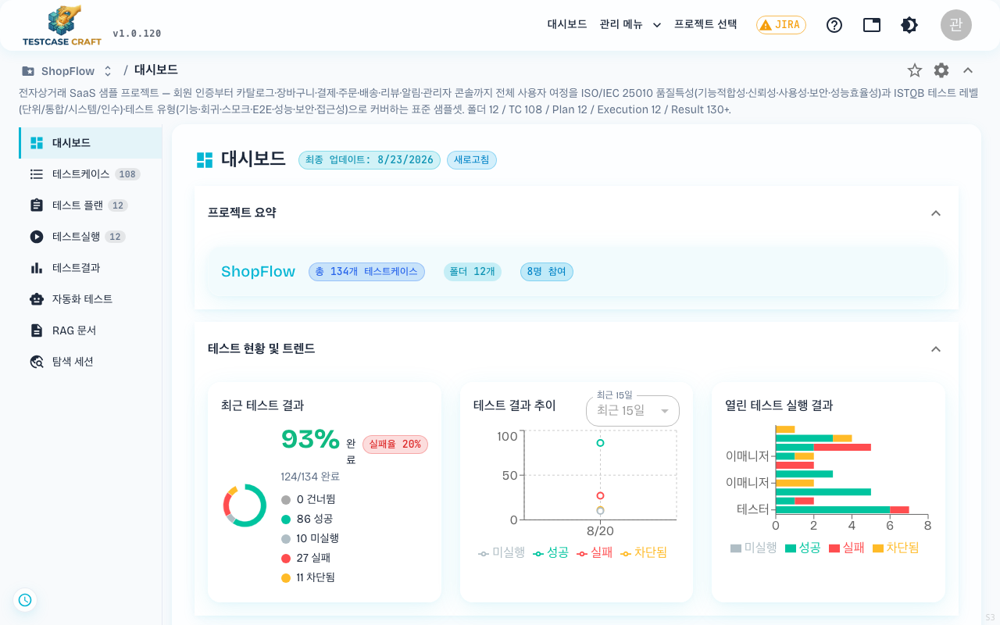

메뉴 아래쪽 화살표로 접으면 아이콘만 남아 본문이 넓어집니다.

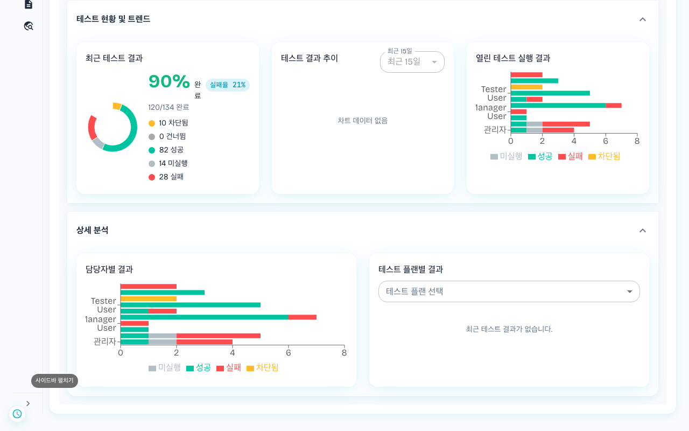

좌측 메뉴에서는 브레드크럼 첫 자리가 **프로젝트 선택기**입니다(`ShopFlow / 대시보드`). 프로젝트 이름을 누르면 목록이 펼쳐지고, 보고 있던 영역을 유지한 채 다른 프로젝트로 넘어갑니다. 프로젝트 이름이 두 군데 나오지 않도록 기존 `프로젝트 /` 크럼은 접힙니다.

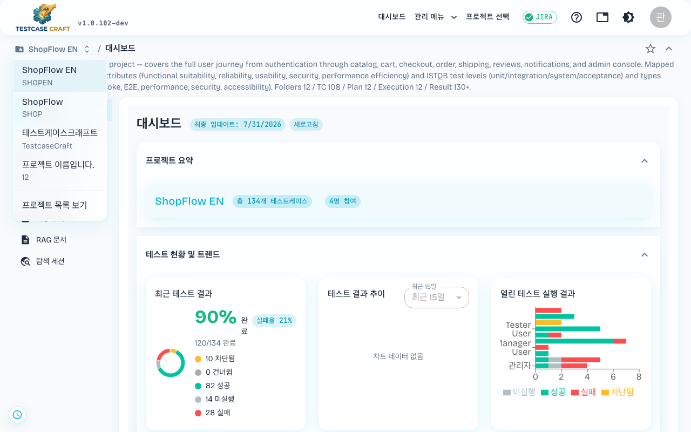

### 3-3. 헤더 도구 (다크모드 · 언어 · 프로젝트 선택)

#### 다크모드 토글

헤더 우상단의 **◐** (반달 모양) 아이콘을 클릭하면 라이트 ⇄ 다크 모드가 즉시 전환됩니다.

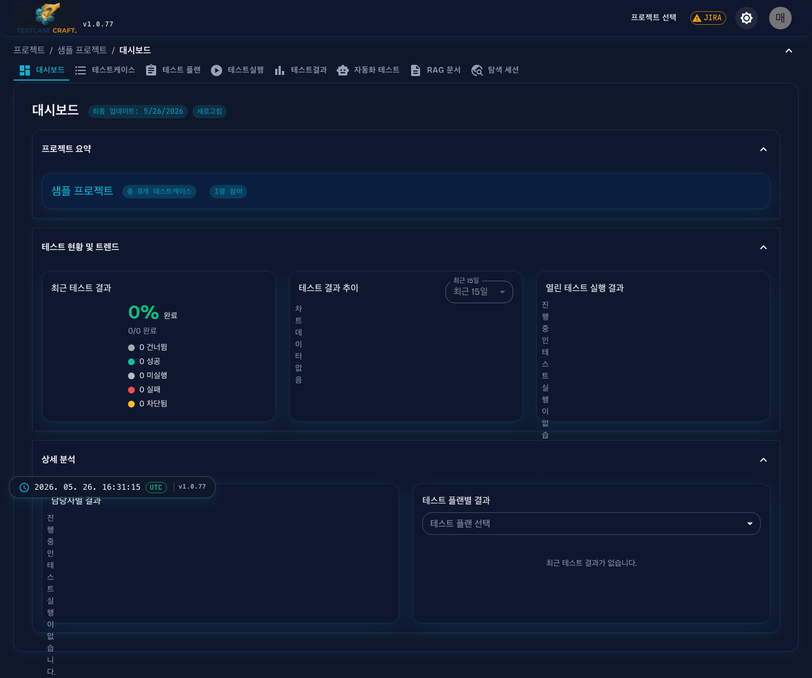

#### 언어 선택

화면 언어는 **프로필 → 언어 설정** 탭에서 변경합니다 ([15-3. 언어 & 시간대 설정](15_내계정_설정.md#15-3-언어--시간대-설정) 참고). 변경 즉시 화면 전체에 반영되며 별도 저장 버튼 없이 자동 저장됩니다.

#### 프로젝트 선택 (빠른 전환)

헤더의 **[프로젝트 선택]** 을 클릭하면 현재 사용자가 속한 프로젝트 목록이 드롭다운으로 펼쳐집니다.

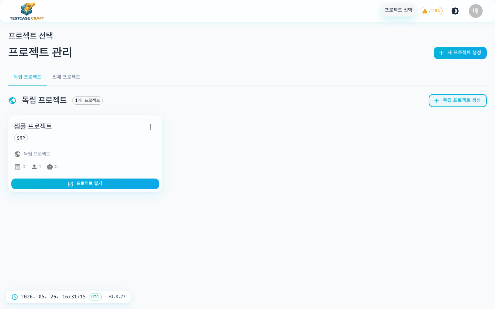

다른 프로젝트로 즉시 전환 가능 — 현재 탭(대시보드/테스트케이스 등) 위치는 유지된 채 프로젝트만 변경됩니다.

### 3-4. 로그아웃

헤더 우상단 **사용자 아바타** → **[로그아웃]** 을 클릭하면 로그인이 해제되고 로그인 화면으로 이동합니다.

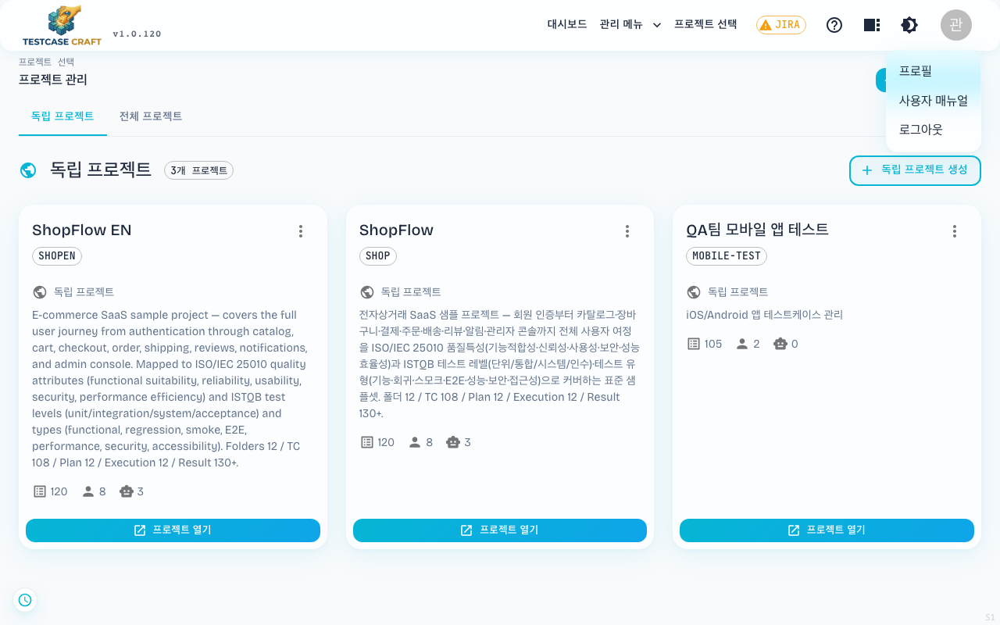

> 일정 기간 사용하지 않으면 보안을 위해 자동으로 로그아웃됩니다. 유지 기간은 운영 환경 설정에 따라 다르므로(개발 환경 약 30일, 운영 환경 기본 90일) 정확한 값은 운영 담당자에게 확인하세요. 로그아웃된 후에는 다시 로그인하면 됩니다.
