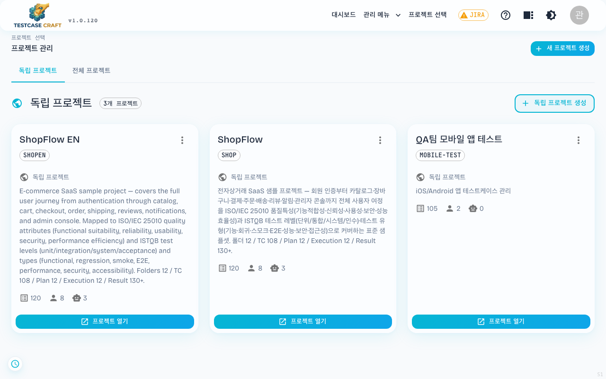
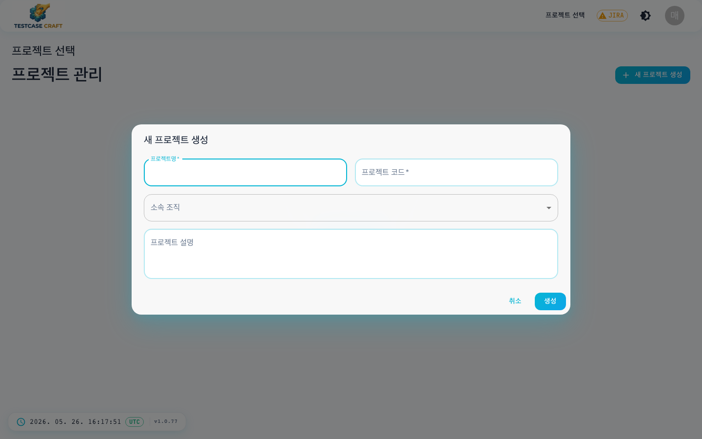
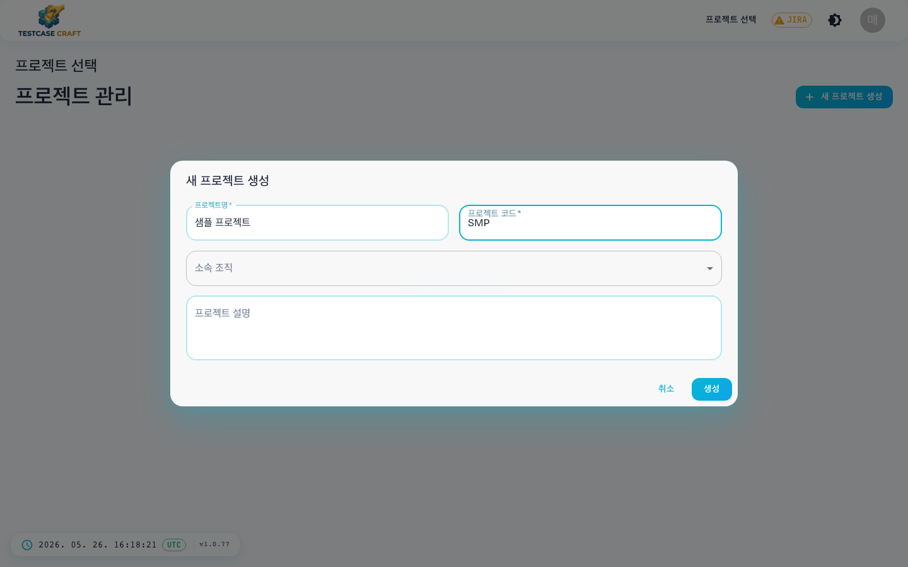
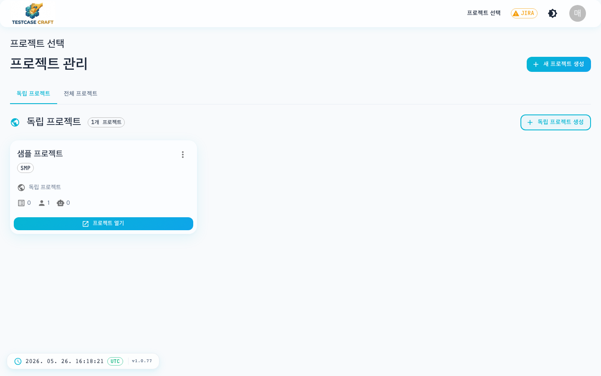

## 4. 프로젝트 만들기

신규 사용자는 참여 중인 프로젝트가 없으므로 빈 화면이 보입니다.

우상단의 **[+ 새 프로젝트 생성]** 또는 가운데의 **[+ 프로젝트 생성]** 버튼을 클릭하면 다이얼로그가 열립니다.

### 4-1. 프로젝트 생성 다이얼로그

다이얼로그에서 다음을 입력합니다.

| 항목 | 예시 | 비고 |
|---|---|---|
| 프로젝트 이름 | `샘플 프로젝트` | 화면에 표시되는 이름 |
| 프로젝트 코드 | `SMP` | 테스트케이스 식별 ID 접두어 (예: `SMP-001`) |
| 설명 | `쇼핑몰 결제 기능 QA` | 선택 입력 — 프로젝트 카드와 설정 화면에 표시됩니다 |

**[생성]** 버튼을 누르면 프로젝트가 만들어지고 카드 형태로 노출됩니다.

### 4-2. 생성된 프로젝트 카드

- 상단 **[독립 프로젝트] / [전체 프로젝트]** 탭으로 범위 전환
- 카드에는 **케이스 수 / 멤버 수 / 자동화 수** 가 작게 표시
- **[프로젝트 열기]** 버튼으로 진입
