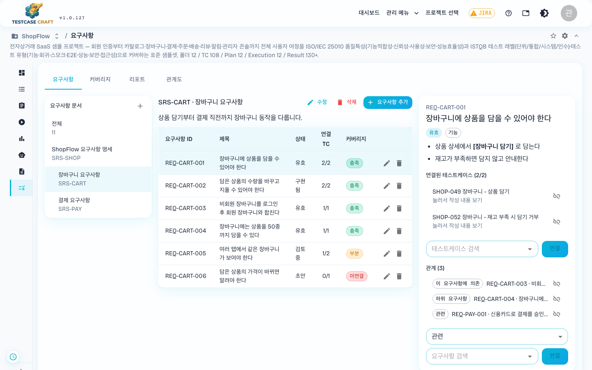
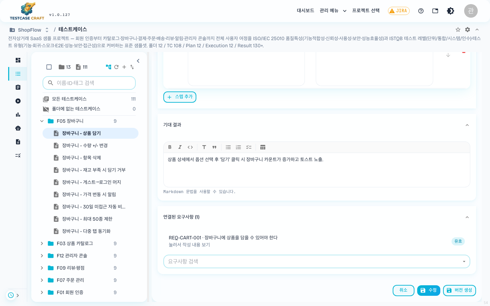
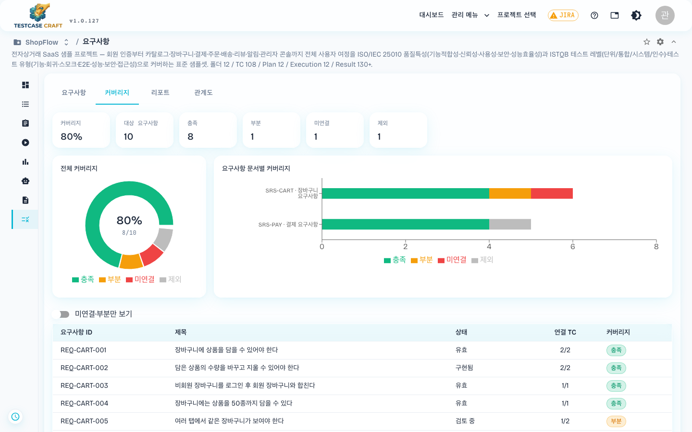
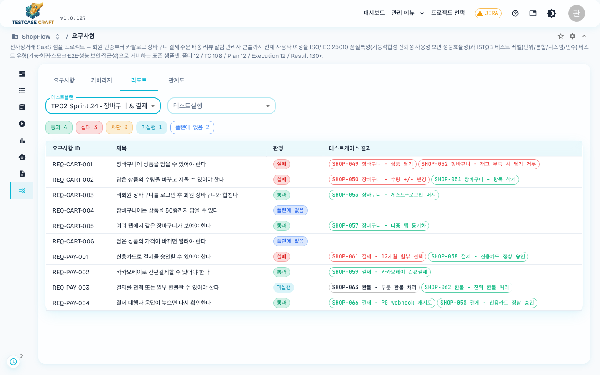
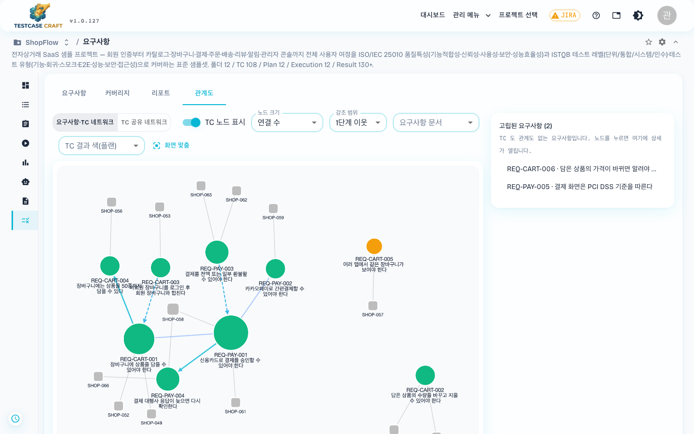

## 5. 요구사항과 커버리지

요구사항을 등록해 두고 테스트 케이스와 연결하면 두 가지를 확인할 수 있습니다. 첫 번째는 테스트 케이스가 하나도 없는 요구사항이 남아 있는지이고, 두 번째는 테스트를 돌린 뒤 요구사항마다 통과했는지입니다. 기획서나 명세서를 기준으로 테스트하는 팀이라면 케이스를 쓰기 전에 요구사항부터 등록합니다.

> 💡 **이 장은 선택입니다.** 요구사항을 관리하지 않는 팀은 이 장을 건너뛰고 [6장 테스트 케이스 작성](06_테스트케이스_작성.md#6-테스트-케이스-작성)으로 가도 됩니다. 요구사항 없이도 케이스·플랜·실행·결과 기능은 모두 그대로 쓸 수 있습니다. 나중에 요구사항을 등록해 이미 쓴 케이스와 연결해도 됩니다.

요구사항을 쓰는 순서는 다음과 같습니다.

1. 요구사항 문서와 요구사항을 등록합니다([5-1절](#5-1-요구사항-문서와-요구사항-만들기)).
2. 테스트 케이스를 작성합니다([6장](06_테스트케이스_작성.md#6-테스트-케이스-작성)).
3. 케이스와 요구사항을 연결합니다([5-2절](#5-2-테스트-케이스-연결)). 케이스 화면에서 작성하면서 바로 연결해도 됩니다.
4. 커버리지 탭에서 케이스가 빠진 요구사항이 없는지 확인합니다([5-4절](#5-4-커버리지-탭)).
5. 테스트를 실행한 뒤 리포트 탭에서 요구사항마다 판정을 봅니다([5-5절](#5-5-리포트-탭)).

이 장의 그림은 ShopFlow 샘플 프로젝트에 들어 있는 요구사항 예시(문서 3개, 요구사항 11개)입니다.

요구사항은 상단(또는 좌측 메뉴)의 **[요구사항]** 탭에서 다룹니다.

| 하위 탭 | 하는 일 |
|---|---|
| **요구사항** | 요구사항 문서와 요구사항을 만들고 고칩니다. 테스트 케이스를 연결하고 요구사항끼리 관계를 겁니다 |
| **커버리지** | 요구사항마다 연결된 케이스가 충분한지 봅니다 |
| **리포트** | 테스트 플랜을 골라 요구사항마다 통과·실패 판정을 봅니다 |
| **관계도** | 요구사항과 케이스가 어떻게 이어져 있는지 그림으로 봅니다 |

> 필요한 역할: 만들기·고치기·연결·삭제는 CONTRIBUTOR · DEVELOPER · LEAD_DEVELOPER · PROJECT_MANAGER 가 할 수 있습니다. VIEWER 와 TESTER 는 볼 수만 있습니다([18장](18_역할과_권한.md#18-역할과-권한)).

### 5-1. 요구사항 문서와 요구사항 만들기

요구사항 탭의 왼쪽은 **요구사항 문서** 트리, 가운데는 고른 문서(하위 문서 포함)에 속한 요구사항 표, 오른쪽은 고른 요구사항의 상세입니다. 왼쪽에서 **전체** 를 고르면 프로젝트의 모든 요구사항이 표에 나옵니다.

요구사항은 반드시 문서 하나에 속합니다. 문서가 없으면 **요구사항 문서를 먼저 추가하세요.** 라는 안내가 나옵니다.

**문서 만들기**

1. 왼쪽 **요구사항 문서** 제목 옆의 **+** 를 누릅니다. 고른 문서를 고치거나 지우려면 표 위의 **수정**·**삭제** 를 누릅니다.
2. 아래 항목을 채우고 저장합니다.

| 항목 | 설명 |
|---|---|
| 문서 ID | 문서를 구분하는 번호입니다(예: `SRS-LOGIN`). 같은 프로젝트 안에서 겹칠 수 없습니다 |
| 제목 | 문서 이름입니다 |
| 상위 문서 | 다른 문서 아래에 두려면 고릅니다. `(최상위)` 면 맨 위에 놓입니다 |
| 범위·설명 | 문서가 다루는 범위입니다. 테스트 케이스와 같은 마크다운 편집기로 작성합니다 |

**요구사항 만들기**

1. 왼쪽에서 문서를 고르고 표 위의 **[+ 요구사항 추가]** 를 누릅니다.
2. 아래 항목을 채우고 저장합니다.

| 항목 | 설명 |
|---|---|
| 요구사항 ID | 요구사항 번호입니다(예: `REQ-001`). 같은 프로젝트 안에서 겹칠 수 없습니다 |
| 제목 | 한 줄 요약입니다 |
| 요구사항 문서 | 속할 문서입니다. 나중에 바꾸면 다른 문서로 옮겨집니다 |
| 유형 | 기능 · 사용자 인터페이스 · 비기능 · 시스템 기능 · 유스케이스 · 제약 · 정보 중 하나 |
| 상태 | 아래 표의 여덟 가지 중 하나 |
| 필요 TC 수 | 이 요구사항을 충분히 확인하려면 케이스가 몇 개 필요한지 적습니다. 기본값은 1입니다. 커버리지 판정에 쓰입니다 |
| 범위·설명 | 요구사항 본문입니다. 마크다운 편집기로 작성합니다 |

| 상태 | 쓰는 때 | 커버리지 계산 |
|---|---|---|
| 초안 · 검토 중 · 재작업 · 작성 완료 · 유효 · 구현됨 | 요구사항의 작성·구현 단계에 맞춰 고릅니다 | 포함 |
| 테스트 불가 | 테스트로 확인할 수 없는 요구사항입니다 | **제외** |
| 폐기 | 더 이상 쓰지 않는 요구사항입니다 | **제외** |

### 5-2. 테스트 케이스 연결

요구사항 화면이나 테스트 케이스 화면에서 연결합니다. 요구사항 화면에서 연결한 케이스는 케이스 화면의 **연결된 요구사항** 칸에도 나타나고, 반대 방향도 마찬가지입니다.

**요구사항 화면에서 연결**

1. 가운데 표에서 요구사항을 고릅니다.
2. 오른쪽 상세의 **연결된 테스트케이스** 영역에서 **테스트케이스 검색** 칸에 이름이나 표시 ID를 넣고 케이스를 고른 뒤 **[연결]** 을 누릅니다.
3. 빼려면 그 케이스 줄 오른쪽의 연결 해제 아이콘을 누릅니다.

**테스트 케이스 화면에서 연결**

케이스 편집 화면에 **연결된 요구사항** 칸이 있습니다. **요구사항 검색** 칸에서 고르는 즉시 저장되므로 따로 저장 버튼을 누를 필요가 없습니다. 프로젝트에 요구사항이 하나도 없으면 이 칸은 나오지 않습니다.

**연결된 상대 내용 보기**

- 요구사항 화면에서 연결된 케이스를 누르면(**눌러서 작성 내용 보기**) 케이스의 단계와 기대 결과가 창으로 열립니다. 케이스가 여러 개면 창을 닫지 않고 **[이전]**·**[다음]** 으로 넘겨 봅니다. **테스트케이스 화면으로 이동** 을 누르면 그 케이스 화면으로 넘어갑니다.
- 케이스 화면에서 연결된 요구사항을 누르면 요구사항의 범위·설명이 창으로 열리고, **요구사항 화면으로 이동** 으로 요구사항 화면에 갈 수 있습니다.
- 연결된 케이스가 많으면 목록이 접힙니다. **연결된 TC 에서 찾기** 칸으로 원하는 케이스를 찾습니다.

> 💡 폴더는 연결할 수 없습니다. 폴더 안의 케이스를 하나씩 연결합니다. 다른 프로젝트의 케이스도 연결할 수 없습니다.

### 5-3. 요구사항 간 관계

요구사항 상세의 **관계** 영역 아래에서 관계 종류를 고르고, **요구사항 검색** 칸에서 상대 요구사항을 고른 뒤 **[연결]** 을 누릅니다. 고를 수 있는 관계는 다섯 가지이며, 화면은 지금 보고 있는 요구사항을 기준으로 이름을 붙입니다.

| 고르는 항목 | 뜻 | 상대 요구사항 화면에서 보이는 이름 |
|---|---|---|
| 하위 요구사항 | 상대가 이 요구사항을 쪼갠 세부 요구사항입니다 | 상위 요구사항 |
| 상위 요구사항 | 상대가 이 요구사항을 포함하는 큰 요구사항입니다 | 하위 요구사항 |
| 의존 대상 | 상대가 먼저 갖춰져야 이 요구사항이 성립합니다 | 이 요구사항에 의존 |
| 이 요구사항에 의존 | 이 요구사항이 먼저 갖춰져야 상대가 성립합니다 | 의존 대상 |
| 관련 | 방향 없이 서로 관련 있습니다 | 관련 |

관계를 지우려면 그 줄 오른쪽의 관계 해제 아이콘을 누릅니다. 아래 경우는 저장되지 않고 안내가 나옵니다.

- 다른 프로젝트의 요구사항과 관계를 거는 경우
- 자기 자신과 관계를 거는 경우
- 이미 같은 관계가 있는 경우
- 하위 요구사항을 다시 상위로 지정해 상위·하위가 돌고 도는 경우

### 5-4. 커버리지 탭

요구사항마다 연결된 케이스 수를 **필요 TC 수** 와 비교해 네 가지로 판정합니다.

| 판정 | 조건 |
|---|---|
| **충족** | 연결된 케이스 수가 필요 TC 수 이상 |
| **부분** | 연결된 케이스가 있지만 필요 TC 수보다 적음 |
| **미연결** | 연결된 케이스가 하나도 없음 |
| **제외** | 상태가 테스트 불가 또는 폐기라서 계산에서 뺌 |

위쪽 요약의 **대상 요구사항** 은 제외를 뺀 요구사항 수이고, **커버리지** 는 그중 충족인 요구사항의 비율입니다. **미연결·부분만 보기** 를 켜면 손볼 요구사항만 남습니다. 그래프는 **전체 커버리지**(도넛)와 **요구사항 문서별 커버리지**(누적 막대) 두 가지입니다.

예시 데이터에서는 REQ-CART-005 가 필요 TC 수 2개 중 1개만 연결되어 부분, REQ-CART-006 이 연결 없이 미연결, REQ-PAY-005 가 테스트 불가라서 제외로 나옵니다.

> 💡 커버리지 탭은 케이스가 연결되어 있는지만 봅니다. 그 케이스가 통과했는지는 리포트 탭에서 확인합니다.

### 5-5. 리포트 탭

테스트 플랜을 고르면 요구사항마다 판정이 나옵니다.

1. **테스트플랜** 에서 플랜을 고릅니다. 고르기 전에는 **리포트를 볼 테스트플랜을 고르세요.** 가 보입니다.
2. **테스트실행** 에서 범위를 고릅니다. 기본값 **플랜 전체 (TC별 최신 결과)** 는 그 플랜의 모든 실행에서 케이스마다 가장 최근 결과를 기준으로 합니다. 특정 실행 하나만 보려면 그 실행을 고릅니다.

판정은 요구사항에 연결된 케이스 가운데 고른 플랜에 들어 있는 케이스의 결과로 정합니다. 결과가 섞여 있으면 아래 순서에서 앞선 것이 판정이 됩니다.

| 순서 | 판정 | 조건 |
|---|---|---|
| 1 | **실패** | 하나라도 실패 |
| 2 | **차단** | 실패는 없고 하나라도 차단 |
| 3 | **미실행** | 실패·차단은 없고 아직 결과가 없는 케이스가 있음. 건너뜀(SKIPPED)도 미실행으로 셉니다 |
| 4 | **통과** | 모두 통과 |
| - | **플랜에 없음** | 연결된 케이스가 고른 플랜에 하나도 없음 |

케이스가 많은 요구사항은 결과 칩 몇 개만 보이고 나머지는 `+N` 으로 접힙니다. 칩은 판정 순서(실패 → 차단 → 미실행 → 통과)대로 놓이므로 접혀 있어도 판정 이유가 보입니다.

예시 데이터에서 플랜 `TP02 Sprint 24 - 장바구니 & 결제` 를 고르면 통과 4, 실패 3, 미실행 1, 플랜에 없음 2가 나옵니다. REQ-CART-004 는 연결된 케이스(최대 50종 제한)가 이 플랜에 없어서 플랜에 없음입니다.

### 5-6. 관계도 탭

요구사항과 케이스를 점(노드)과 선으로 그려 보여 줍니다. 어느 요구사항에 케이스가 몰려 있는지, 케이스도 관계도 없이 떨어져 있는 요구사항이 무엇인지 찾을 때 이 탭을 엽니다.

| 설정 | 선택지 |
|---|---|
| 보기 | **요구사항·TC 네트워크**: 요구사항과 케이스를 함께 그리고, 요구사항 관계와 케이스 연결을 선으로 표시합니다 / **TC 공유 네트워크**: 요구사항만 그리고, 같은 케이스에 연결된 요구사항끼리 선으로 표시합니다. 선 두께와 숫자는 두 요구사항이 공유하는 케이스 수입니다 |
| 노드 크기 | **연결 수**(선이 많을수록 큼) 또는 **매개 중심성**(다른 요구사항 사이를 잇는 자리일수록 큼) |
| 강조 범위 | 노드를 누르면 **1단계 이웃** 또는 **2단계 이웃** 까지 강조합니다 |
| 요구사항 문서 | 고른 문서의 요구사항만 그립니다 |
| TC 노드 표시 | 요구사항·TC 네트워크에서 케이스 노드를 숨기거나 보입니다 |
| TC 결과 색(플랜) | 플랜을 고르면 케이스 노드를 그 플랜의 최신 결과 색으로 칠합니다. **표시 안 함** 이면 칠하지 않습니다 |

그래프가 화면을 벗어나면 **[화면 맞춤]** 을 누릅니다. 오른쪽에는 선이 하나도 없는 **고립된 요구사항** 목록이 나오고, 노드를 누르면 그 자리에 요구사항 상세가 열립니다.

그림에서 큰 원은 요구사항, 회색 네모는 테스트 케이스입니다. 실선 화살표는 상위·하위, 점선 화살표는 의존, 점선은 관련 관계이고, 가는 회색 선은 케이스 연결입니다. 오른쪽 목록의 REQ-CART-006 과 REQ-PAY-005 는 케이스도 관계도 없어서 그래프에 나오지 않습니다.

### 5-7. 알아둘 점

- ⚠️ **문서를 지우면 하위 문서와 그 안의 요구사항, 케이스 연결이 모두 함께 지워집니다.** 테스트 케이스 자체는 지워지지 않습니다. 삭제 전에 확인 창이 한 번 나옵니다.
- ⚠️ **요구사항을 지우면 그 요구사항의 케이스 연결과 관계도 함께 지워집니다.** 더 쓰지 않는 요구사항은 지우는 대신 상태를 **폐기** 로 바꾸면 기록이 남고 커버리지 계산에서도 빠집니다.
- 문서를 자기 자신이나 자기 하위 문서 아래로 옮길 수 없습니다.
- 서버 오류 안내 문구는 화면 언어와 관계없이 영어로 나옵니다.
