## 6. 테스트 케이스 작성

상단 **[테스트케이스]** 탭으로 진입합니다.

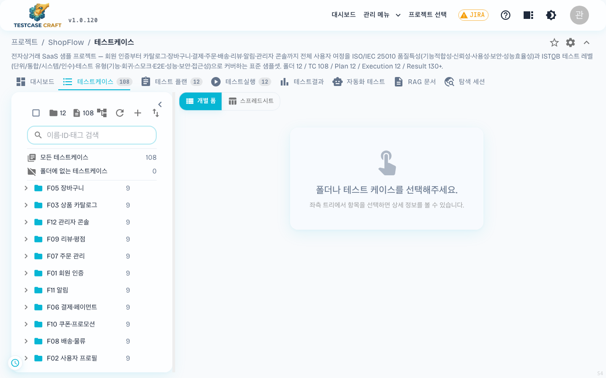

> **2026-05-29 변경**: 폼 상단의 모드 제목 글줄이 제거되었습니다. 어떤 케이스를 편집 중인지는 헤더 좌측의 **표시 ID 배지** (예: `SMP-001`) 로 확인합니다. 모든 메타 섹션은 **접고 펼 수 있는 영역**으로 통일되었습니다. 헤더의 동작 버튼(자동 저장 표시·버전·RAG 배지·저장·취소·버전 생성)은 한 줄로 묶입니다.

> **2026-06-05 변경 (v1.0.80)**: 폼 본문이 **위에서 아래로 한 단(풀폭) 레이아웃** 으로 바뀌었습니다. 메타데이터·기본 정보 섹션이 먼저 나오고, 그 아래에 테스트 단계(스텝)·기대 결과 섹션이 화면 전체 폭을 사용해 배치됩니다. 와이드 모니터(1920px 등)에서도 이름·설명·스텝 표가 좌측 절반에 갇히지 않고 넓게 펼쳐져, 긴 스텝과 기대 결과를 한결 편하게 작성할 수 있습니다.

> **2026-05-29 변경 (v1.0.79)**: **테스트 단계(스텝)와 기대 결과 입력칸의 높이가 내용에 맞춰 자동으로 조절**됩니다. 비어 있을 때는 한 줄 높이만 차지하고, 내용을 입력하면 줄 수만큼 늘어나다가 **최대 10줄에서 멈추고 칸 안에서 스크롤**됩니다. 긴 SQL·로그·시나리오를 붙여 넣어도 폼 전체가 끝없이 길어지지 않으며, 같은 행의 스텝 칸과 기대 결과 칸은 높이가 서로 맞춰져 나란히 비교하기 좋습니다.

### 6-1. 화면 구성

| 영역 | 설명 |
|---|---|
| 왼쪽 패널 | **테스트 케이스 트리** — 기본적으로 폴더만 표시하되, 트리 모양 아이콘 버튼으로 케이스도 함께 표시하는 전체 트리 모드로 전환 가능 |
| 왼쪽 위 도구 줄 | ☑ 전체 선택 / 📁 폴더 수 / 📄 케이스 수 / 🔄 새로고침 / 🌳 트리 모드 전환 / ↕ 순서 편집 |
| 왼쪽 필터 창 | **폴더 필터** — 폴더 이름으로 트리를 검색하고 X 버튼으로 해제 |
| 오른쪽 본문 | **폴더 케이스 목록** 또는 **스프레드시트(표)** — 폴더 선택 시 하위 케이스 목록, 입력 모드 선택 시 스프레드시트 전환 |
| 본문 위 도구 줄 | `+ 행 추가`, `위에 추가`, `아래에 추가`, `폴더 추가`, `삭제`, `검증`, `가져오기/내보내기`, `톱니바퀴(옵션)`, `전체화면`, `일괄 저장` |

> **2026-06-06 변경**: 트리 기본 표시 모드가 "폴더만"으로 바뀌었습니다. 우측 패널에는 선택한 항목(폴더/케이스)에 따라 **폴더 케이스 목록 테이블**이 표시되고, 입력 모드 버튼으로 스프레드시트 모드로 전환할 수 있습니다. 트리 헤더의 트리 모양 아이콘 버튼으로 "트리에 케이스도 표시"하는 기존 혼합 모드로 복구 가능합니다. 트리 헤더 아래에 폴더 이름 필터 검색창이 추가되어 원하는 폴더를 빠르게 찾을 수 있습니다.

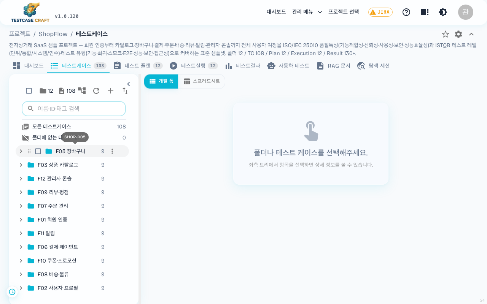

#### 폴더 케이스 목록

트리에서 폴더를 선택하면 오른쪽에 직속 하위 폴더와 **하위 폴더를 포함한 모든 테스트케이스**가 표 형태로 나타납니다.

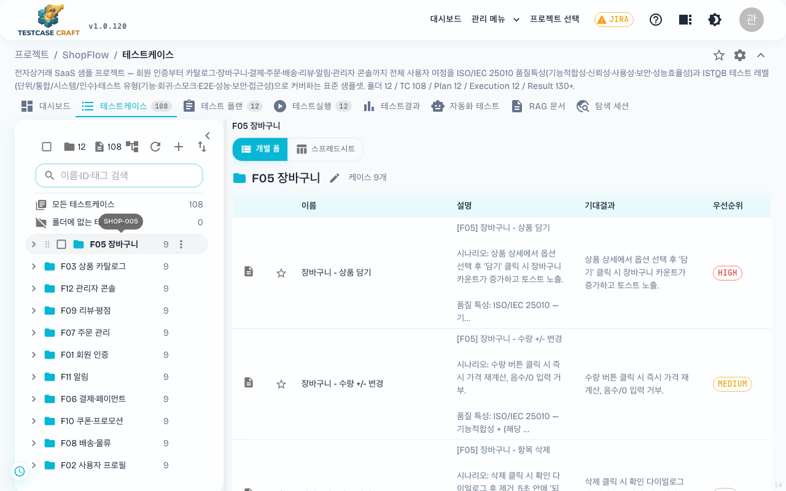

- **컬럼 구성** — 이름 → 설명 → 기대결과 → 우선순위 순서입니다.
- **하위 폴더 케이스 포함** — `폴더 > 폴더 > 케이스`처럼 중첩된 구조라도 상위 폴더만 선택하면 그 아래 모든 케이스가 함께 표시됩니다. 하위 폴더 소속 케이스에는 **폴더** 컬럼이 추가되어 선택한 폴더 기준의 상대 경로를 보여주고, 경로를 클릭하면 해당 폴더로 이동합니다.
- **긴 내용 처리** — 텍스트가 100자를 넘으면 말줄임(…)되고, 마우스를 올리면 전체 내용이 툴팁으로 표시됩니다.
- **기대결과** — 케이스의 통합 기대결과를 우선 표시하고, 없으면 스텝별 기대결과를 번호를 매겨 보여줍니다.
- **행 클릭** — 케이스를 클릭하면 상세 폼이 열리고, 하위 폴더를 클릭하면 그 폴더의 목록으로 이동합니다.
- **경로 표시** — 본문 맨 위에 `상위폴더 › 하위폴더 › 케이스명` 형태로 현재 위치가 표시되고, 상위 폴더를 클릭해 바로 이동할 수 있습니다.

#### 폴더 정보 편집

폴더 케이스 목록 상단의 폴더명 옆 **연필 아이콘**을 클릭하면 폴더 정보 편집 폼으로 전환됩니다.

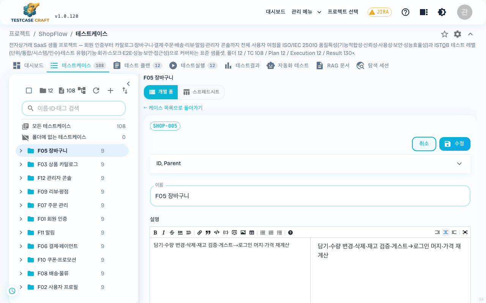

| 필드 | 설명 |
|---|---|
| **이름** | 폴더 이름을 변경합니다. 트리의 우클릭 → "이름 변경"과 같은 결과입니다. |
| **설명** | 폴더의 용도·범위를 마크다운 에디터로 작성합니다. 작성한 설명은 폴더 케이스 목록의 참고 정보가 됩니다. |
| **태그** | 폴더 분류용 태그를 추가합니다. |

- **[수정]** 버튼으로 저장하면 자동으로 케이스 목록으로 돌아갑니다.
- 저장하지 않고 돌아가려면 상단의 **"← 케이스 목록으로 돌아가기"** 링크를 클릭하세요.
- 다른 폴더나 케이스를 선택하면 편집 모드가 자동으로 해제됩니다.

### 6-2. 입력 모드 선택

본문 좌측 상단에 **[개별 폼] / [스프레드시트]** 토글 버튼이 항상 표시됩니다. 한 번의 클릭으로 입력 방식을 바꿀 수 있습니다.

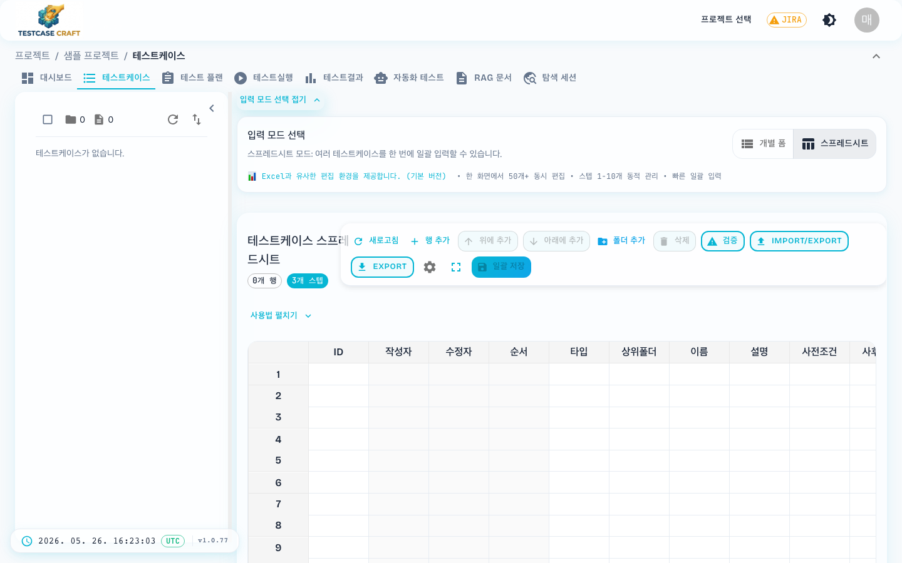

- **스프레드시트 모드** — 표 형태로 여러 케이스를 한 번에 입력 (기본). 엑셀과 비슷한 사용감으로, 행 추가 → 셀 입력 → 일괄 저장 흐름으로 빠르게 작성합니다.
- **폼(개별 폼) 모드** — 한 건씩 항목별로 자세히 입력. 모든 필드를 지원하고 스텝 수 제한이 없어, 사전·사후 조건이나 첨부가 많은 케이스를 꼼꼼히 작성할 때 적합합니다.

> 선택한 입력 모드는 사용자별로 서버에 저장되어, 다른 PC 에서 로그인해도 마지막에 쓰던 모드가 그대로 복원됩니다.

> **참고**: 이전 버전에 있던 **고급 스프레드시트** 모드는 현재 임시로 숨겨져 있습니다. 추후 업데이트에서 다시 제공될 수 있으며, 그때까지는 기본 스프레드시트 모드를 사용하시면 됩니다.

> **2026-05-29 변경**: 스프레드시트 셀에 한글 30자(약 480px)를 넘는 긴 내용이 들어오면 **자동 워드랩** 됩니다. 컬럼이 가로로 늘어나지 않고 그 행의 높이만 늘어나므로 한 화면에서 여러 케이스를 비교하기 쉽습니다.

### 6-3. 행 추가 다이얼로그

스프레드시트 상단의 **[+ 행 추가]** 를 누르면 추가할 행 개수를 묻는 다이얼로그가 뜹니다.

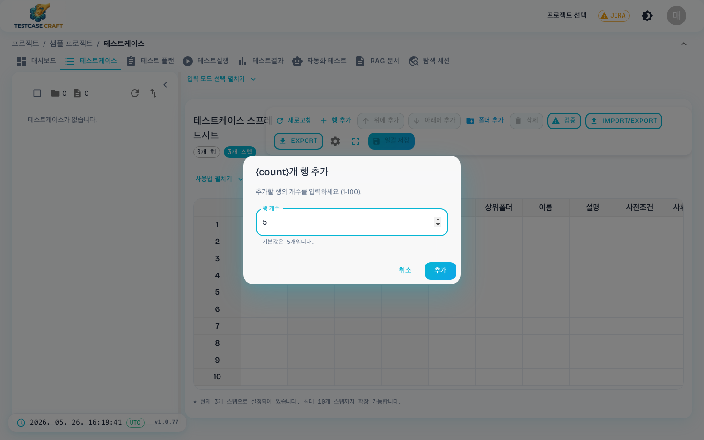

기본 5개, 1~100개까지 한 번에 추가할 수 있습니다. **[추가]** 를 누르면 빈 행이 생기고 ID·이름·설명·사전조건·단계(스텝) 등을 채우면 됩니다. 작성이 끝나면 우상단 **[💾 일괄 저장]** 으로 한 번에 저장합니다.

### 6-4. 폴더와 케이스 트리 구조

TestcaseCraft는 폴더와 케이스를 **하나의 트리**로 관리합니다.

- **폴더** (`📁`) — 케이스를 묶어서 분류하는 단위
- **케이스** (`📄`) — 실제 테스트 시나리오
- **시스템 기본 폴더** — 프로젝트가 만들어질 때 자동으로 생기는 보호 폴더입니다. 실수 방지를 위해 이동·삭제할 수 없습니다.

트리 헤더에는 현재 **폴더 수(📁)와 케이스 수(📄)** 가 함께 표시되어 프로젝트 규모를 바로 가늠할 수 있습니다.

#### 트리 뷰 모드

트리는 기본적으로 **폴더만 표시**합니다. 트리 헤더의 **트리 모양 아이콘 버튼**(🌳)을 클릭하면 "폴더만 표시" ↔ "트리에 케이스도 표시"(전체 혼합 모드)로 전환됩니다. 설정은 브라우저에 저장되어 다음 방문 시 유지됩니다.

> **2026-06-06 변경**: 테스트플랜에서 케이스를 선택하는 화면(선택 모드)에서는 항상 케이스가 포함된 전체 트리가 표시됩니다.

#### 가상 노드 (모든 케이스 / 폴더에 없는 케이스)

트리 상단에는 고정 행 2개가 있습니다:
- **모든 테스트케이스** — 전체 케이스 수
- **폴더에 없는 테스트케이스** — 폴더 미지정 케이스 수

이 행을 클릭하면 우측에 해당 케이스 목록이 표시됩니다. 이 목록에는 맨 앞에 **폴더**(경로) 컬럼이 추가되어 각 케이스의 소속 폴더를 확인할 수 있고, 경로를 클릭하면 해당 폴더로 바로 이동합니다.

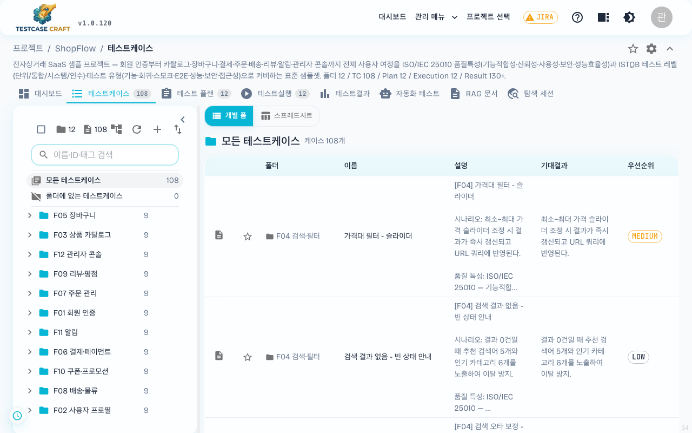

#### 트리 필터

트리 헤더 아래의 **검색창**을 사용해 케이스와 폴더를 찾습니다. 검색 안내는 **"이름·ID·태그 검색"**입니다.

- **폴더 필터** (구 이름) — 폴더 이름으로 트리를 검색하고 추립니다. 부분 일치로 작동하며, 일치 항목의 상위 경로는 유지되고 자동으로 펼쳐집니다.
- **표시 ID 검색** — 케이스의 표시 ID(예: `TC-12`)를 검색합니다. 부분 일치 지원.
- **태그 검색** — 케이스에 붙은 태그로도 검색합니다.
- **복합 검색** — 콤마(`,`)로 여러 검색어를 구분해 입력하면, 각각 조건을 만족하는 항목을 함께 표시합니다.
- **전체 선택 시** — 검색으로 좁혀진 상태에서 트리 헤더의 **☑ 전체 선택**을 누르면, 화면에 보이는 결과만 선택됩니다 (숨겨진 항목은 제외).

X 버튼으로 필터를 해제합니다.

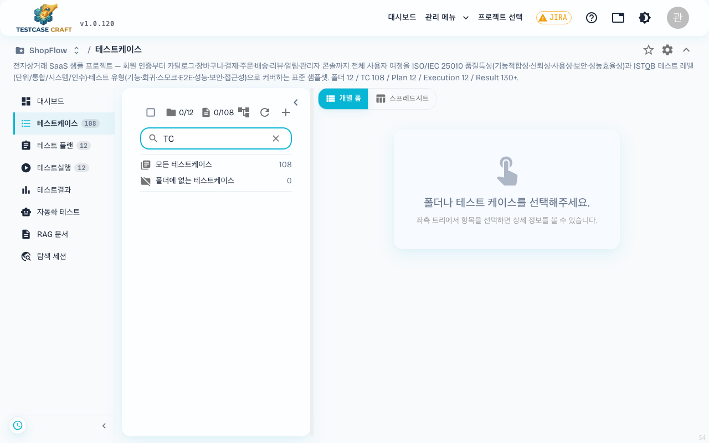

#### 폴더/케이스 추가

폴더/케이스를 추가하는 방법은 두 가지입니다.

1. 좌측 트리 헤더의 **➕** 아이콘 클릭 (편집 권한이 있을 때 노출)
2. 트리의 폴더 위에서 **마우스 우클릭** → 컨텍스트 메뉴 선택

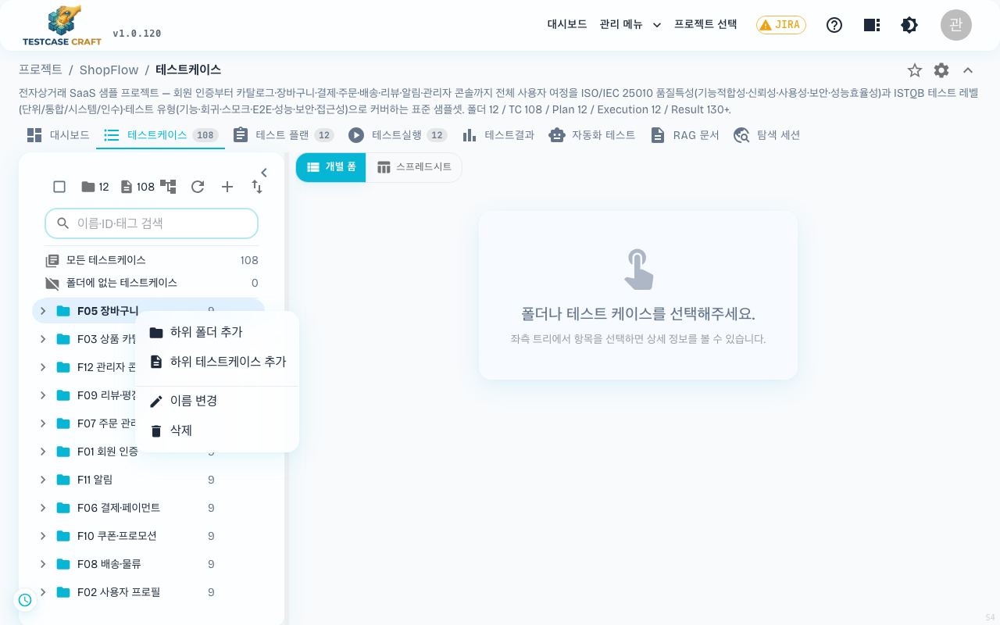

우클릭 메뉴에서 할 수 있는 일:

| 메뉴 | 동작 |
|---|---|
| **하위 폴더 추가** | 선택한 폴더 안에 새 폴더를 만듭니다 |
| **하위 테스트케이스 추가** | 선택한 폴더 안에 새 케이스를 만듭니다 |
| **이름 변경** | 폴더/케이스 이름을 바로 수정합니다 |
| **삭제** | 폴더/케이스를 삭제합니다 (폴더는 안의 내용과 함께 삭제되므로 주의) |

### 6-5. 필드 표시 토글

폼 모드 우상단의 **🔲 (표시할 필드 선택)** 아이콘을 클릭하면 폼에서 보이는 메타 필드를 켜고 끌 수 있습니다.

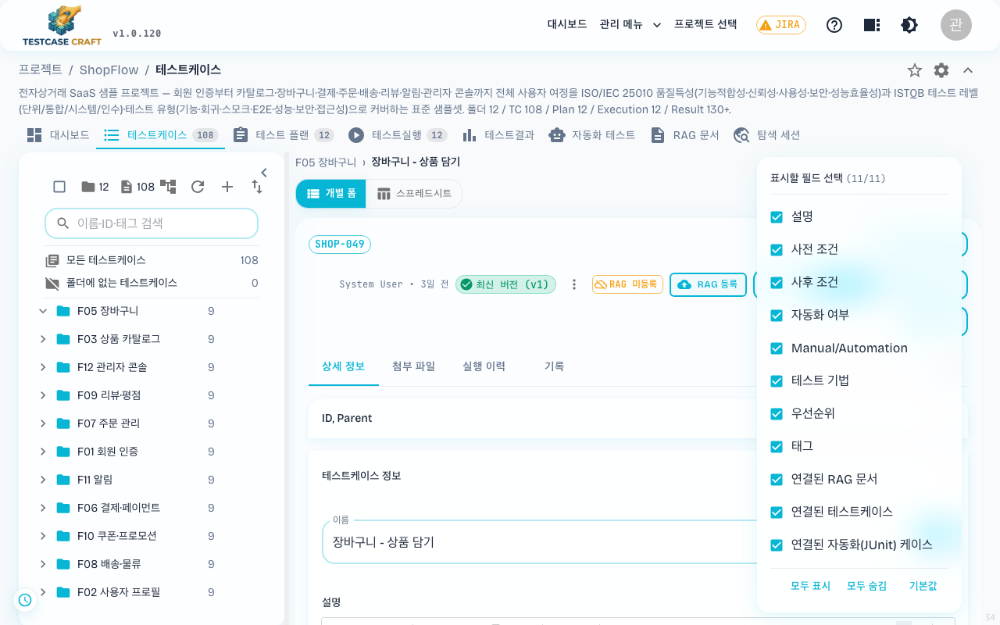

토글 대상 9개 필드:

- 설명
- 사전 조건
- 사후 조건
- 자동화 여부
- Manual / Automation
- 테스트 기법
- 우선순위
- 태그
- 연결된 RAG 문서

> 핵심 필드(이름·스텝·기대 결과)는 항상 표시되며 토글 대상에서 제외됩니다.

팝오버 하단의 **[모두 표시] / [모두 숨김] / [기본값]** 버튼으로 한 번에 정리할 수 있습니다. 선택한 값은 사용자별로 서버에 저장되어 다른 PC 에 로그인해도 동일하게 유지됩니다.

### 6-6. 폼 모드 화면 구성과 메타데이터

폼 모드로 케이스를 열면 다음과 같은 화면이 표시됩니다.

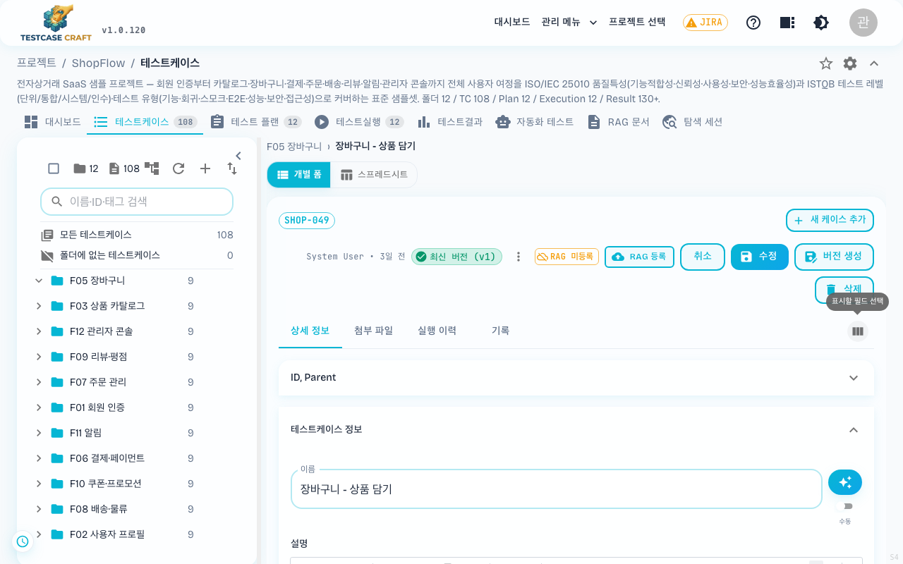

**헤더 영역** (위에서부터):

- **표시 ID 배지** (예: `SHOP-112`) — 지금 편집 중인 케이스
- **버전 표시** (예: `최신 버전 (v2)`) — 클릭하면 버전 이력 확인
- **RAG 등록됨** 배지 — 이 케이스가 RAG 지식 베이스에 등록되어 있다는 표시
- 우측 액션 버튼 — **[취소] / [수정(저장)] / [버전 생성] / [삭제]**

> **2026-07-02 변경 (v1.0.93)**: 저장된 케이스를 편집할 때 헤더 우측에 **[삭제]** 버튼(빨간색)이 표시됩니다. 이제 트리의 삭제와 **똑같은 확인 창**이 뜹니다 — 삭제할 케이스의 **ID·이름을 표로 보여주고**, **[삭제] / [취소]** 로 확정합니다. 권한이 없으면(뷰어 등) 버튼이 보이지 않으며, 삭제 권한이 없는 경우 서버가 돌려준 안내 메시지가 화면 하단에 그대로 표시됩니다.

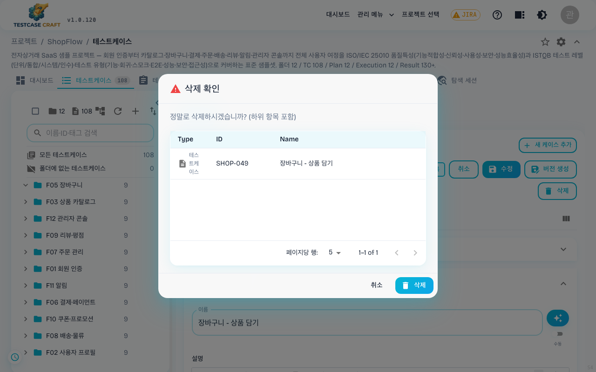

**본문 탭** 4개:

| 탭 | 내용 |
|---|---|
| **상세 정보** | 이름·설명·테스트 단계·기대 결과 등 케이스 본문 (기본 탭) |
| **첨부 파일** | 케이스에 붙인 파일 목록과 업로드 |
| **실행 이력** | 이 케이스의 과거 실행 결과 이력 |
| **기록** | 변경 이력 (누가 언제 무엇을 바꿨는지) |

**메타데이터 영역** (상세 정보 탭 상단의 `ID, Parent` — 접고 펼 수 있음):

- **수정 가능 필드** — 이름, 표시 ID, 설명, 우선순위, 태그 등 (위 [6-5. 필드 표시 토글](#6-5-필드-표시-토글) 토글에 따라 노출)
- **읽기 전용 필드** — 생성일·수정일·작성자·UUID 등 시스템이 채우는 정보. UUID 는 자르지 않고 풀 문자열로 노출되어 외부 시스템 연동·디버깅에 그대로 복사할 수 있습니다.

### 6-7. 북마크 & 즐겨찾기

> **2026-06-09 변경**: 자주 보는 테스트 케이스를 개인 **북마크**로 모아 두는 기능이 추가되었습니다. 북마크는 **나에게만 보이는 개인 정보**이며, 다른 사용자의 화면에는 영향을 주지 않습니다.

**즐겨찾기 추가/제거**

케이스 목록의 각 행 왼쪽에는 별 모양 아이콘이 있습니다.

- **☆ (빈 별)** 클릭 → 즐겨찾기에 추가됩니다.
- **★ (채운 별)** 클릭 → 즐겨찾기에서 제거됩니다.

즐겨찾기에 추가한 케이스는 기본 모음인 **즐겨찾기** 에 담깁니다.

**북마크 화면**

헤더의 **☆** 아이콘을 클릭하면 북마크 화면이 열립니다. 화면은 두 영역으로 나뉩니다.

- **좌측 — 모음 목록**: 케이스를 주제별로 묶는 **모음(컬렉션)**. 기본 **즐겨찾기** 모음은 항상 존재하며 삭제할 수 없습니다. **[모음 만들기]** 로 새 모음을 추가하고, 각 모음은 **이름 변경 · 삭제** 가 가능합니다.
- **우측 — 케이스 목록**: 선택한 모음에 담긴 케이스가 **케이스명 · 우선순위 · 메모 · 동작** 컬럼의 표로 표시됩니다.

각 케이스에는 **개인 메모**를 남길 수 있어, "회귀 때 꼭 확인" 같은 나만의 표시를 붙여 둘 수 있습니다.

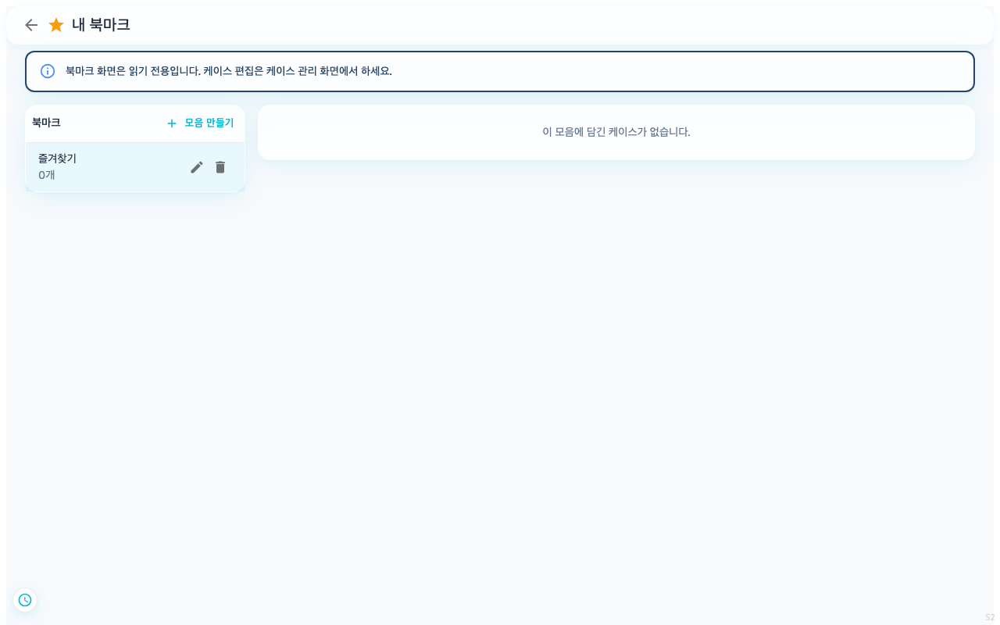

좌측 모음 목록과 우측 케이스 목록으로 나뉜 읽기 전용 북마크 화면입니다.

> ⚠️ 북마크 화면은 **읽기 전용**입니다. 케이스 본문(이름·단계·기대 결과 등)을 고치려면 **테스트케이스** 화면에서 편집하세요. 북마크에서는 모음 정리와 개인 메모만 다룹니다.
