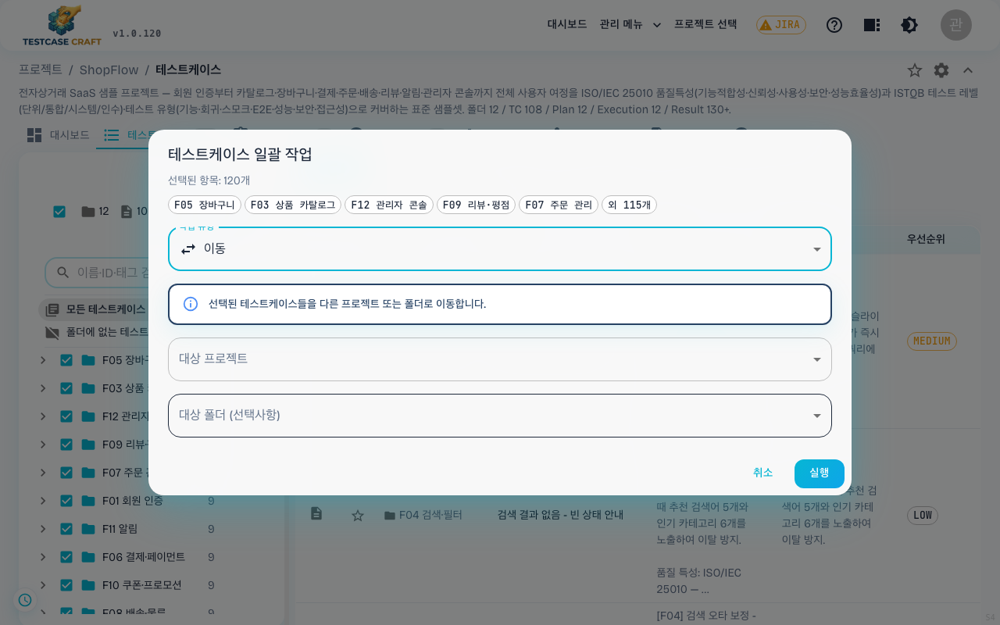

## 7. 테스트 케이스 트리 정리

> 본 기능은 v1.0.77 부터 제공됩니다. 더 자세한 안내는 [`docs/guide/TREE_DND_USER_GUIDE.md`](../../guide/TREE_DND_USER_GUIDE.md) 를 참고하세요.

> **2026-05-29 변경**: 트리의 각 행 좌측에 붙는 **표시 ID 배지** 는 전체 ID 대신 **마지막 번호만**(예: `SMP-001` → `001`) 짧게 표시됩니다. 배지에 마우스를 올리면 전체 ID 가 풍선 도움말로 보입니다. 행 이름도 폭이 좁아 잘릴 때만 마우스를 올리면 전체 이름이 표시되어, 평소엔 화면이 더 깔끔합니다.

### 7-1. 동작 요약

기존의 **우클릭 메뉴**(추가/이름변경/삭제)와 **순서 편집 모드**(↑/↓ 버튼)는 그대로 사용 가능하며, 추가로 다음과 같이 **마우스 드래그**로 위치를 바꿀 수 있습니다.

| 하고 싶은 것 | 동작 |
|---|---|
| 케이스를 다른 폴더로 옮기기 | 케이스 행 좌측 **`⋮⋮`(드래그 핸들)** 을 잡고 끌어 폴더 위에 놓기 |
| 폴더 통째로 옮기기 | 폴더 행의 드래그 핸들을 잡고 다른 폴더 위에 놓기 |
| 같은 폴더 안에서 순서 바꾸기 | 항목과 항목 사이의 **가는 간격** 에 놓기 |
| 루트로 이동 | 트리 최상단 빈 영역에 놓기 |

각 행 좌측의 **점 6개 모양 아이콘(⋮⋮)** 이 드래그 핸들입니다. 평소에는 숨겨져 있다가 **행에 마우스를 올리면** 나타납니다. 이 핸들을 잡아야 드래그가 시작됩니다. 드롭 직전 어디에 들어갈지 **연한 가이드 라인** 으로 미리 보입니다.

> **2026-06-06 변경**: 드래그 핸들은 평소 숨겨져 있다가 행에 마우스를 올렸을 때만 나타납니다. 체크박스·버전 히스토리·더보기(⋮) 버튼도 호버 시에만 노출됩니다.

### 7-2. 다중 선택 이동

여러 항목을 한 번에 옮길 수 있습니다.

1. **체크박스** 또는 `Cmd-click`(Mac) / `Ctrl-click`(Win)로 여러 노드 선택
2. 선택된 묶음 중 **하나의 드래그 핸들** 을 잡고 끌기 → 묶음 전체가 함께 이동
3. 서버에는 한 번의 요청으로 전송되며, 하나라도 실패하면 **전체가 원래 상태로 되돌아갑니다** (부분 적용 없음)

### 7-3. 자동 차단되는 이동

다음은 드래그 중 가이드가 **빨간색** 으로 바뀌며 자동 차단됩니다.

- 자기 자신 또는 자기 안에 있는 폴더로 옮기기 (예: A 폴더를 A 안의 B 폴더로 이동)
- 다른 프로젝트의 폴더로 옮기기 (드래그로는 불가 — 대신 아래 [7-5. 다른 프로젝트로 이동·복사](#7-5-다른-프로젝트로-이동복사) 의 **[프로젝트 이동/복사]** 기능을 사용하세요)
- 테스트 케이스 **안에** 다른 항목 넣기 (케이스는 자식을 가질 수 없음)
- 시스템 기본 폴더 옮기기

거부되면 화면 하단의 알림으로 이유를 알려주고, 트리는 즉시 원래대로 돌아갑니다.

### 7-4. 이동 기록 (감사 로그)

모든 성공한 이동은 시스템에 자동으로 기록됩니다 — **누가, 언제, 어디서 어디로 옮겼는지** 관리자가 추적할 수 있습니다. 실수로 옮긴 경우 관리자에게 문의하면 원위치를 찾을 수 있습니다.

### 7-5. 다른 프로젝트로 이동·복사

> **2026-07-02 추가 (v1.0.93)**: 선택한 테스트 케이스(폴더면 하위 전체)를 **다른 프로젝트로 이동하거나 복사**할 수 있습니다. 같은 프로젝트 안에서 위치만 바꾸는 드래그앤드롭([7-1. 동작 요약](#7-1-동작-요약)~5-4)과 달리, 프로젝트를 넘나드는 작업은 전용 버튼으로 수행합니다.

**여는 방법**

1. 트리에서 옮길 케이스·폴더의 **체크박스**로 하나 이상 선택합니다.
2. 트리 헤더에 나타나는 **[프로젝트 이동/복사]** 버튼을 클릭합니다. (선택한 항목이 있을 때만 보입니다.)
3. **테스트케이스 일괄 작업** 다이얼로그가 열립니다. 상단에 선택한 항목 수와 이름이 표시됩니다.

**이동 / 복사 실행**

1. **작업 유형** 에서 **이동** 또는 **복사** 를 선택합니다.
2. **대상 프로젝트** 를 선택합니다 (필수). 선택하면 그 프로젝트의 폴더 목록이 자동으로 불러와집니다.
3. **대상 폴더** 를 선택합니다 (선택 사항). 지정하지 않으면 대상 프로젝트의 **루트 폴더** 로 들어갑니다.
4. **[실행]** 을 누르면 작업이 처리되고, 완료 후 트리가 갱신됩니다. **이동**한 경우 옮겨진 항목은 현재 프로젝트 트리에서 사라집니다.

**이동과 복사의 차이 — 테스트 결과 처리**

| 작업 | 케이스 | 테스트 결과 | 필요한 권한 |
|------|--------|------------|------------|
| **이동** | 대상 프로젝트로 옮겨짐 (출발에서 사라짐) | 연결된 결과도 **함께 이동** — 대상 프로젝트에 대응 실행을 새로 만들어 결과를 옮겨 담습니다 (JIRA 버그·첨부·태그·실행자·실행 시각 보존) | 출발·대상 프로젝트 **모두 편집 권한** |
| **복사** | 대상 프로젝트에 **복제** (출발은 그대로) | **가져오지 않음** — 케이스만 복제됩니다 | 출발 **조회 권한** + 대상 **편집 권한** |

> ⚠️ 시스템 기본 폴더는 이동·복사 대상으로 선택할 수 없습니다. 대상 프로젝트에서의 편집 권한이 없으면 실행이 거부되고 화면 하단에 안내 메시지가 표시됩니다.
