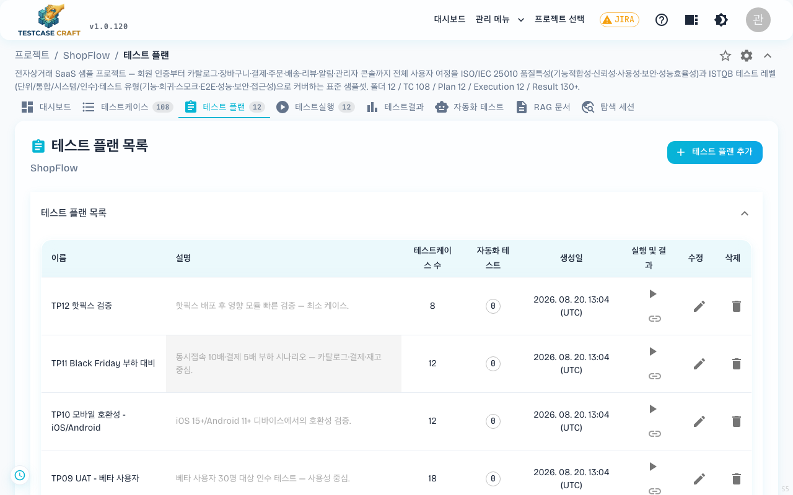
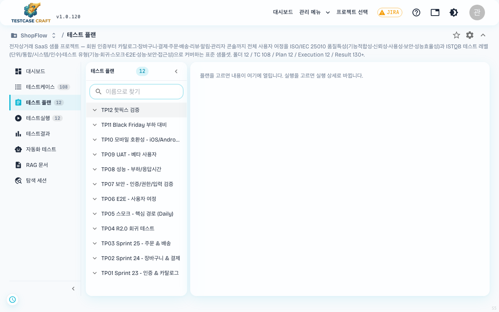
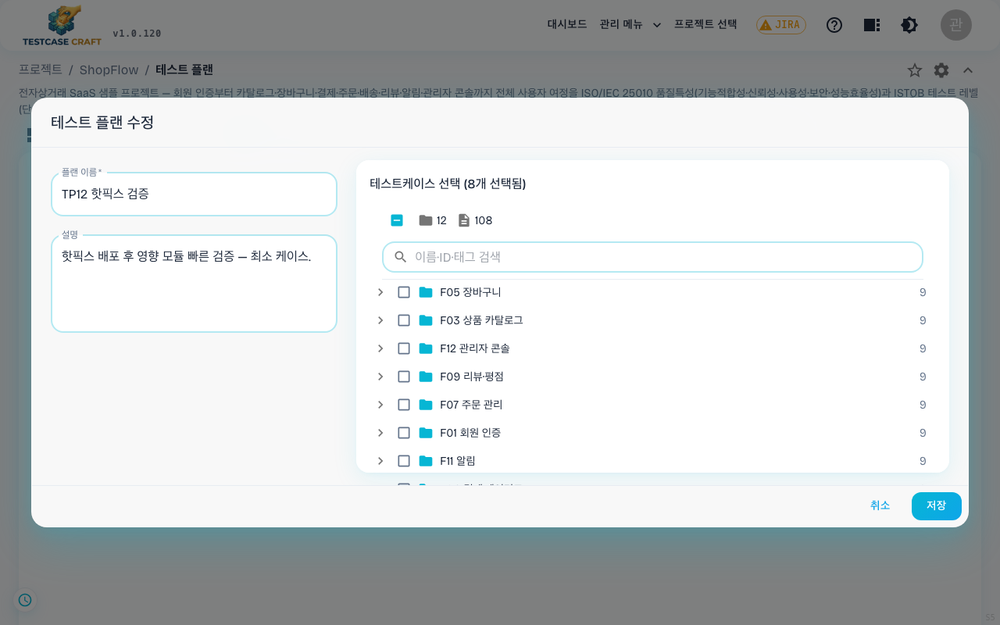
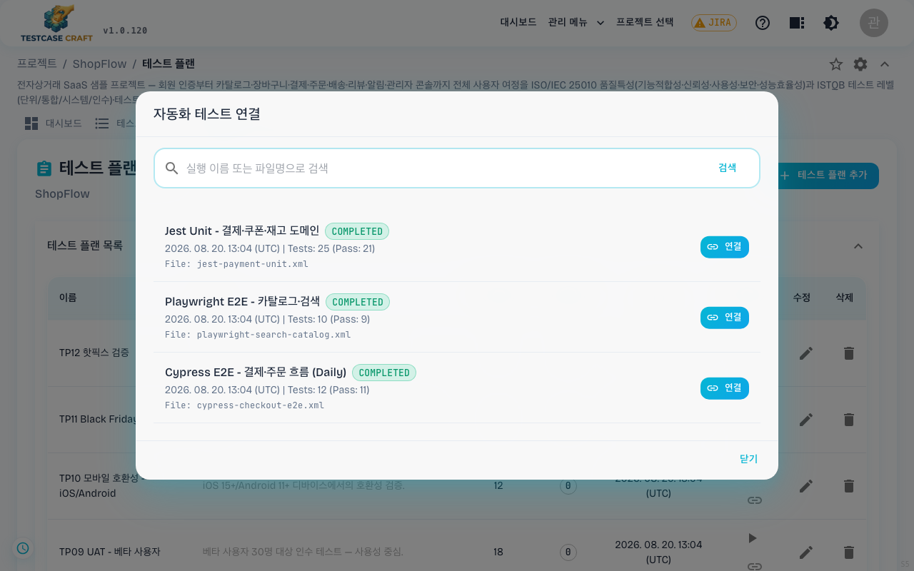
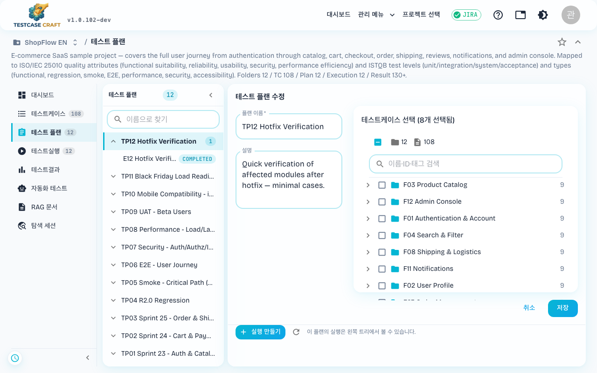

## 8. 테스트 플랜

상단 **[테스트 플랜]** 탭에서 한 묶음의 테스트케이스를 실행 단위로 묶은 **테스트 플랜**을 관리합니다.

- 우상단 **[+ 새 플랜]** 버튼으로 신규 플랜 생성 (이름, 설명, 포함할 케이스 선택)
- 플랜 목록에서 카드/행 클릭 → 상세 진입
- 플랜에 묶인 케이스는 "테스트 실행"에서 한 번에 실행 가능

> 신규 프로젝트라 플랜이 비어 있는 상태입니다. 플랜을 만들면 카드로 보입니다.

#### 플랜 만들기

왼쪽에 이름과 설명을 넣고, 오른쪽 트리에서 담을 케이스를 고릅니다. 폴더를 접은 채 폴더 체크박스만 눌러도 그 안의 케이스가 함께 선택됩니다. 검색창은 이름·표시 ID·태그를 함께 찾습니다. 이름은 필수이고, 케이스를 하나도 고르지 않은 플랜도 만들 수 있습니다.

#### 플랜 열기·고치기

같은 폼이 저장된 값과 함께 열립니다. 상단에 담긴 케이스 수가 표시되고, 체크를 풀면 그 케이스는 플랜에서 빠집니다. 이미 실행이 만들어진 플랜에서 케이스를 빼도 지난 실행의 결과는 그대로 남습니다.

#### 자동화 테스트 연결

플랜 목록 각 행의 **🔗 자동화 테스트 연결** 아이콘을 누르면 그 플랜에 자동화 테스트를 붙이는 창이 열립니다. 행에 표시된 숫자 칩이 현재 연결된 개수이고, 칩을 눌러도 같은 창이 열립니다.

- 목록에는 업로드된 자동화 실행이 **실행 이름 · 상태 · 업로드 시각 · 테스트 수(통과 수) · 파일명** 과 함께 나옵니다.
- 검색창은 **실행 이름 또는 파일명**으로 찾습니다. 원하는 항목의 **[연결]** 을 누르고, 이미 붙은 항목은 **[연결 해제]** 로 떼어 냅니다.
- **이 아이콘은 플랜을 관리할 수 있는 역할에만 보입니다**(PM·LEAD). VIEWER·TESTER·DEVELOPER 로 로그인하면 아이콘이 없습니다.
- 연결해 두면 테스트결과 화면의 **자동화 테스트** 집계에 그 플랜 몫으로 함께 잡힙니다.

> **2026-07-31 변경 (신규 레이아웃)**: 좌측 메뉴 레이아웃을 선택하면, 테스트 플랜이 **목록 + 상세 2단** 화면으로 표시됩니다. 왼쪽에는 플랜 트리(플랜 아래에 그 플랜의 실행이 표시됨), 오른쪽에는 선택한 플랜의 내용이 나타납니다. 팝업이나 전체 화면으로 빠지지 않고 오른쪽 영역 안에서 완결되며, 가로 탭 레이아웃에서는 기존의 팝업/전체 화면 방식이 그대로 유지됩니다.

왼쪽 가지를 펼치면 그 플랜의 실행이 딸려 나옵니다. 실행을 고르면 오른쪽이 실행 상세로 바뀌고, `플랜으로 돌아가기` 로 플랜 내용으로 되돌아옵니다. 플랜 내용 아래 `실행 만들기` 는 고른 플랜을 그대로 물려받습니다.
