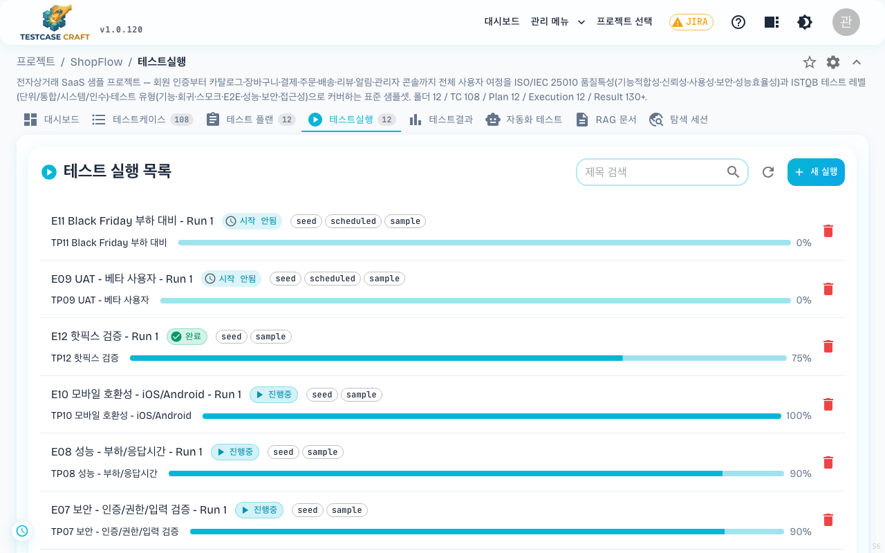
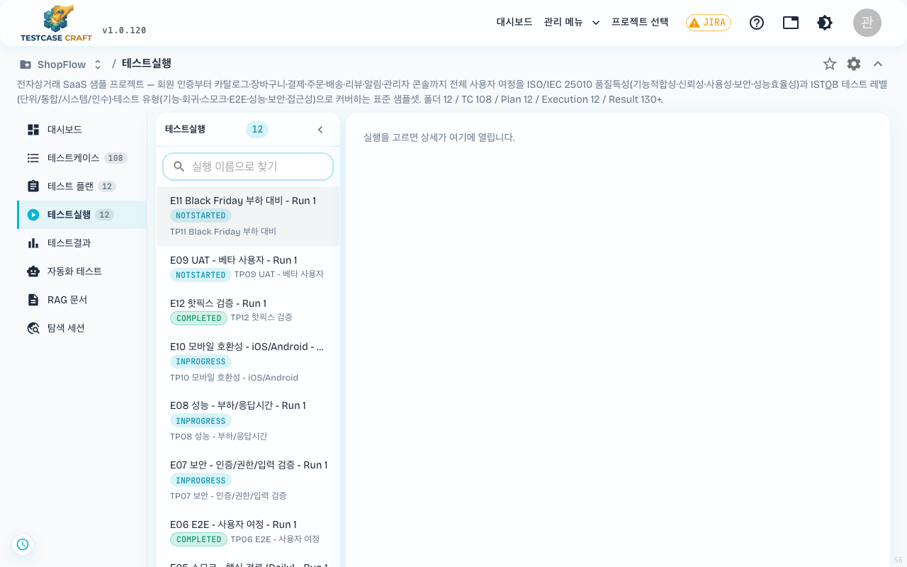
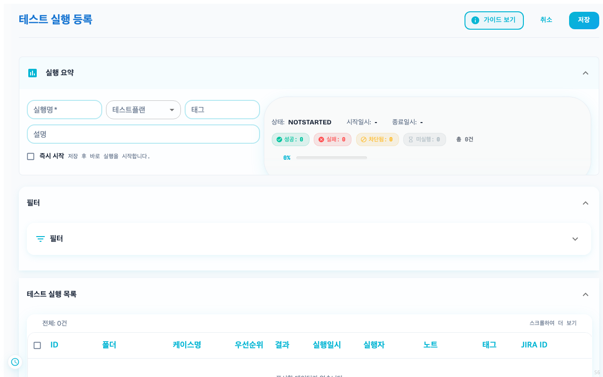
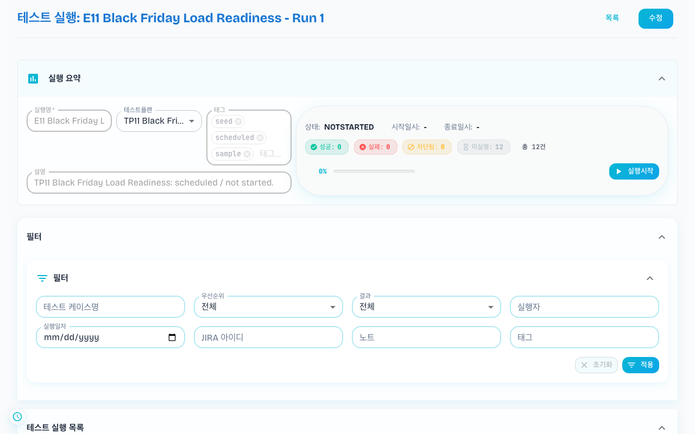
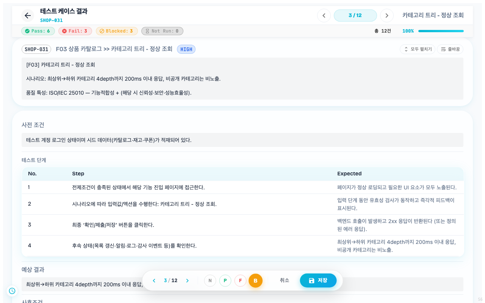
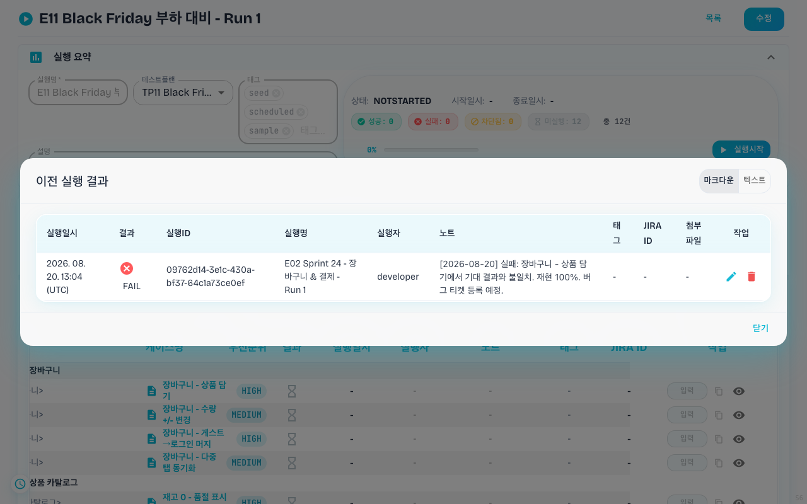

## 9. 테스트 실행

상단 **[테스트실행]** 탭은 테스트 플랜에 묶인 케이스들의 실행 인스턴스를 관리합니다.

- 검색창으로 제목 필터링 (검색어는 프로젝트별로 기억됩니다)
- 행 클릭 → 그 실행 내부로 진입, 각 케이스의 결과(통과/실패/건너뜀/차단)를 기록
- "테스트 결과" 탭은 종료된 실행의 통계를 종합 조회

> **2026-06-09 변경**: 테스트 실행 목록이 **약 20초마다 자동으로 새로고침**되어, 다른 팀원이 기록한 진행 상황이 새로고침 없이 반영됩니다. 다른 탭을 보고 있는 동안에는 자동 갱신이 멈춰 불필요한 요청이 발생하지 않으며, 화면으로 돌아오면 다시 갱신됩니다. 목록 상단의 **[새로고침]** 버튼으로 언제든 즉시 갱신할 수도 있습니다.

> **2026-07-31 변경 (신규 레이아웃)**: 좌측 메뉴 레이아웃에서는 테스트 실행이 **목록 + 상세 2단** 화면으로 표시됩니다. 왼쪽에는 프로젝트의 모든 실행을 최신순으로 나열하고, 오른쪽에는 선택한 실행의 상세(케이스 결과 입력 등)를 표시합니다. 실행 내부의 결과 입력 화면도 전체 화면으로 빠지지 않고, 상단 헤더와 좌측 메뉴를 유지한 채 오른쪽 영역에서 열립니다. 가로 탭 레이아웃에서는 기존 방식이 그대로 유지됩니다.

실행 행에는 상태 칩과 그 실행이 속한 플랜 이름이 함께 붙습니다. 이름으로 찾기는 실행 이름을 서버에서 검색하고, 목록이 길면 아래쪽 `더 보기` 로 이어 받습니다.

#### 실행 만들기

실행명은 필수이고, 테스트플랜을 고르면 그 플랜에 담긴 케이스가 실행 목록으로 딸려 옵니다. **[즉시 시작]** 을 켜면 저장과 동시에 실행이 시작되고, 끄면 `NOTSTARTED` 로 남아 나중에 시작할 수 있습니다. 상단 요약에는 아직 결과가 없어 0건으로 표시됩니다.

수동 실행은 다음 흐름입니다.

1. 테스트 플랜에서 **[실행 시작]** 클릭
2. 케이스 하나씩 진행 — 단계별 기대 결과(expected)/실제 결과(actual) 입력 + 결과 마킹
3. 첨부 파일(스크린샷, 로그 등) 업로드 가능 — TXT·CSV·JSON·MD·PDF·LOG·PNG·JPG·GIF 형식, 파일당 최대 10MB
4. 완료 시 결과는 자동으로 **테스트 결과** 와 **대시보드 통계**에 반영

> **2026-06-09 변경**: 실행 내부의 케이스 목록 위에 **필터 패널**이 추가되어, **결과**(PASS·FAIL·BLOCKED·NOT RUN)·**우선순위**·**실행자**·**실행일자**·**JIRA 아이디**·**노트** 조건으로 케이스를 추려 볼 수 있습니다. 필터가 적용 중이면 **적용 중** 표시가 함께 나타나며, **[초기화]** 로 모든 조건을 한 번에 해제할 수 있습니다.

> **2026-07-31 변경**: 필터 패널에 **태그** 항목이 추가되었습니다. 실행 결과에 붙인 태그로도 필터링할 수 있으며, 다중 선택과 직접 입력을 지원합니다. 결과를 저장할 때 태그를 넣지 않으면 이전 태그를 그대로 물려받습니다 (태그가 사라지지 않음).

### 9-1. 결과 입력 화면

실행 안에서 케이스를 클릭하면 결과 입력 화면이 열립니다. 화면의 플로팅 결과 버튼으로 다음 4가지 상태를 기록합니다.

머리에는 결과별 집계와 전체 진행률이 붙고, `1 / 12` 화살표로 같은 실행의 다음 케이스로 넘어갑니다. 아래에는 케이스의 사전 조건과 단계·기대 결과가 그대로 따라와, 문서를 따로 열지 않고 판정할 수 있습니다.

| 버튼 | 상태 | 의미 |
|---|---|---|
| **P** | 통과 (Pass) | 기대한 대로 동작 |
| **F** | 실패 (Fail) | 기대와 다르게 동작 — 결함 가능성 |
| **B** | 차단됨 (Blocked) | 환경 문제 등으로 실행 자체가 불가 |
| **N** | 미실행 (Not Run) | 아직 실행하지 않음 (기본값) |

결과 외에도 **노트**(자유 메모), **태그**, **JIRA 이슈 키** 를 함께 기록할 수 있고, 하단의 **이전 결과 목록** 에서 이 케이스의 과거 실행 이력을 한눈에 볼 수 있습니다. 이전 결과 목록에서 **이번 실행에 속한 행은 시각적으로 구분 표시** 되어, 어떤 결과가 이번 실행분인지 헷갈리지 않습니다.

> **2026-07-31 추가**: 결과 입력 화면의 상단 근처에 **"테스트케이스 첨부파일"** 영역이 표시됩니다. 여기서 이 테스트케이스에 붙어 있는 첨부파일(스크린샷, 스크립트, 증빙 문서 등)을 함께 볼 수 있습니다. 첨부파일의 다운로드 링크를 열었을 때 오류가 표시되면 페이지를 새로고침하면 목록이 자동으로 갱신됩니다.

**이전 실행 결과 다이얼로그 — 노트 보기 형식 토글**

> **2026-06-10 추가**: 테스트 케이스 실행 목록에서 케이스의 **[이전 결과]** 버튼을 누르면 **이전 실행 결과** 다이얼로그가 열립니다. 이 다이얼로그 우측 상단에 **마크다운 / 텍스트** 보기 형식 토글이 있습니다.

- **마크다운** (기본): 노트를 마크다운 서식으로 렌더링해 표·목록·코드 블록 등을 보기 좋게 표시합니다.
- **텍스트**: 노트를 서식 변환 없이 **원문 그대로** 표시합니다. 마크다운 형식이 아닌 노트가 깨져 보이는 경우 이 모드로 원문을 확인하세요.

선택한 보기 형식은 브라우저에 저장되어, 다음에 다이얼로그를 다시 열 때도 그대로 유지됩니다.

### 9-2. 자동 저장 — 보기만 하면 절대 저장되지 않습니다

> **2026-06-05 변경 (v1.0.80)**: 결과 입력의 자동 저장 동작이 안전하게 재설계되었습니다.

- **확인만 하면 저장되지 않습니다** — 결과 입력 화면을 열어 내용을 둘러보거나, 다음/이전 버튼으로 케이스를 넘기기만 하는 경우에는 어떤 저장도 일어나지 않습니다. 기존에 입력해 둔 결과가 바뀔 걱정 없이 자유롭게 열람하세요.
- **수정하면 자동 저장됩니다** — 결과 버튼(P/F/B/N)·노트·태그·JIRA 키 중 하나라도 실제로 수정하면, 약 1.5초 후 자동으로 저장됩니다. 저장 여부는 화면 상단의 자동 저장 상태 표시로 확인할 수 있습니다.
- **빈 결과는 만들어지지 않습니다** — 아무것도 입력하지 않은 상태(미실행 + 빈 노트)에서 저장이나 다음 버튼을 눌러도 빈 레코드가 생성되지 않으며, 이전 결과가 그대로 유지됩니다.

> 💡 v1.0.80 부터는 보기만 해서는 빈 기록이 새로 생기지 않습니다. 이전 버전에서 이미 쌓여 있던 빈 미실행 기록은, 해당 케이스에 실제 결과를 입력하면 그 기록이 갱신되어 자연스럽게 정리됩니다.
