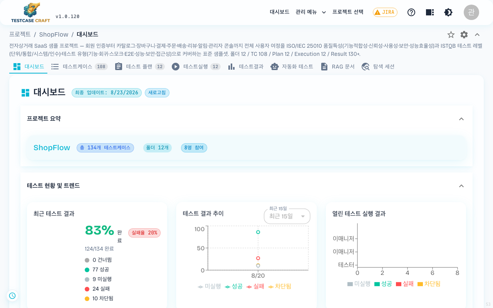
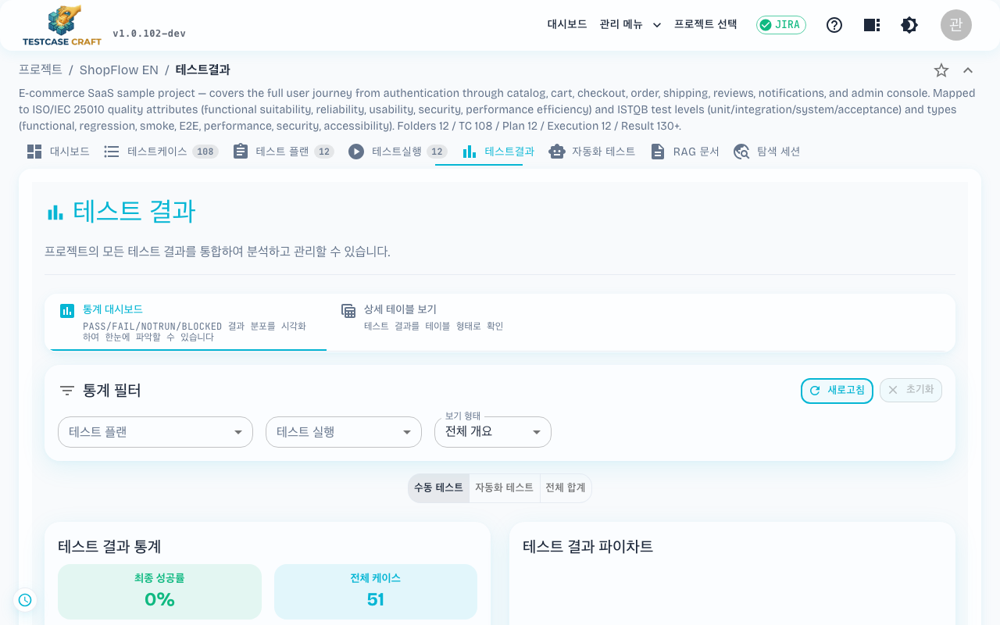
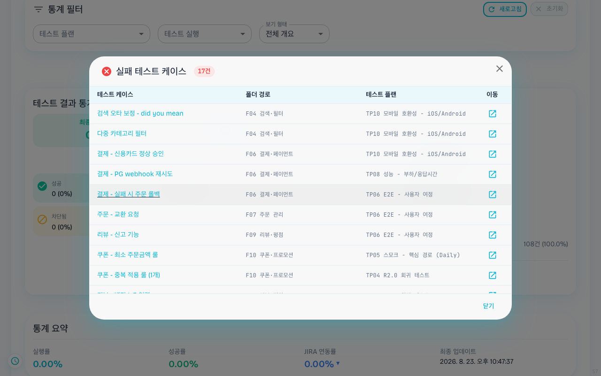
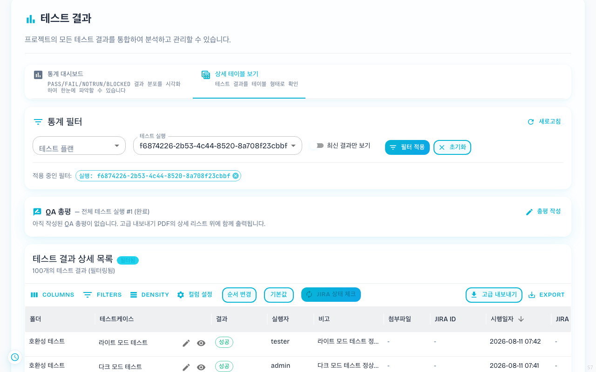

## 10. 결과와 리포트

### 10-1. 대시보드와 통계

프로젝트 상단 **[대시보드]** 탭(`/projects/{projectId}` 진입 시 기본 화면)은 그 프로젝트의 핵심 지표를 한 화면에 정리해 줍니다. 전사 단위로 보려면 헤더의 **대시보드** 메뉴로 `/dashboard` 에 접근합니다.

| 카드 | 설명 |
|---|---|
| 프로젝트 요약 | 케이스 수 · 참여 인원 |
| 최근 테스트 결과 | 성공 / 실패 / 미실행 / 건너뜀 / 차단됨 비율 |
| 테스트 결과 추이 | 최근 며칠간의 진행 흐름 차트 |
| 열린 테스트 실행 결과 | 진행 중인 실행 요약 |
| 담당자별 결과 | 멤버별 케이스 진행 상황 |
| 테스트 플랜별 결과 | 플랜 단위 통계 |

화면 위 **[새로고침]** 을 누르면 최신 데이터로 갱신됩니다. **[최근 15일 ▾]** 으로 표시 기간을 바꿀 수 있습니다.

### 10-2. 테스트 결과

상단 **[테스트결과]** 탭은 종료된 실행의 결과를 종합 조회합니다.

- 필터: 기간, 플랜, 담당자, 결과 상태
- 케이스 단위 통과율, 최근 N회 추이 차트
- 결과 보고서를 파일로 내보내기 가능 — 형식은 3가지입니다.

**보기 형태 바꾸기** — 통계 필터의 **보기 형태** 를 바꾸면 같은 결과를 다른 기준으로 묶어 봅니다. 고른 형태는 주소에 남아(`?viewType=by-folder`) 링크로 그대로 공유됩니다.

| 보기 형태 | 주소에 남는 값 | 무엇으로 묶는가 |
|---|---|---|
| 개요 | `overview` | 프로젝트 전체 한 장 요약 |
| 폴더별 | `by-folder` | 트리 폴더 기준 — 어느 기능 묶음이 약한지 |
| 플랜별 | `by-plan` | 플랜 기준 — 어느 릴리즈 묶음이 약한지 |
| 실행별 | `by-execution` | 실행 회차 기준 — 회차 간 추이 |
| 실행자별 | `by-executor` | 사람 기준 — 업무 분포 |

아래쪽 **수동 테스트 / 자동화 테스트 / 전체 합계** 토글로 어느 결과를 셀지도 함께 정합니다.

| 형식 | 이런 분께 추천 |
|---|---|
| **Excel (.xlsx)** | 통계 차트가 포함된 보고서를 그대로 공유·필터링하고 싶을 때 |
| **PDF (.pdf)** | 인쇄하거나 레이아웃이 고정된 문서로 보관하고 싶을 때 — 가로/세로 방향 선택 가능 |
| **CSV (.csv)** | 가볍게 데이터만 뽑아 다른 도구에서 분석하고 싶을 때 |

> **2026-06-05 변경 (v1.0.80)**: PDF 내보내기에서 긴 테스트 단계(스텝/기대 결과) 정보가 페이지 경계에서 잘리던 문제가 해결되어, 여러 페이지에 걸쳐 온전히 출력됩니다.

#### 미실행·실패 케이스 목록 바로 열기

통계 카드의 항목 중 **미실행**과 **실패** 옆에는 `▼` 표시가 붙습니다. 그 항목을 누르면 해당 케이스가 무엇인지 목록으로 펼쳐집니다. 숫자만 보고 트리를 뒤질 필요가 없습니다.

- 목록은 **테스트 케이스 · 폴더 경로 · 테스트 플랜 · 이동** 네 칸으로 나옵니다.
- **[이동]** 을 누르면 그 케이스 화면으로 바로 넘어갑니다.
- 통과·차단 항목에는 `▼` 가 붙지 않습니다. 눌러도 아무 일이 없는 것이 정상입니다.

#### QA 총평

테스트결과 화면의 **상세 테이블 보기** 탭에서 **테스트 실행 필터를 하나 선택하면**, 결과 테이블 위에 **"QA 총평"** 패널이 표시됩니다. 해당 실행을 마치고 난 뒤의 평가·소견·후속 조치 등을 자유롭게 기록해 두는 공간입니다.

- 패널의 **[총평 작성]**(이미 작성된 총평이 있으면 **[수정]**) 버튼을 누르면 **마크다운 에디터**가 열립니다. 입력하는 동안 우측에 **라이브 프리뷰**가 함께 표시되어 결과를 바로 확인하며 작성할 수 있습니다. 최대 10,000자까지 입력할 수 있습니다.
- 작성한 총평은 **테스트 실행(execution) 단위**로 저장됩니다. 실행 필터를 바꾸면 각 실행에 작성된 총평이 따로 표시되며, 패널 헤더에는 **작성자와 마지막 수정 시각**이 함께 나타납니다.
- **고급 내보내기 PDF**에는 통계 요약 다음, **"상세 테스트 결과 리스트"** 제목 바로 위에 **"💬 QA 총평"**(작성자 포함)이 함께 출력됩니다. 마크다운 서식은 일반 텍스트로 변환되어 들어갑니다. 단, **Excel·CSV 내보내기에는 포함되지 않습니다.**
