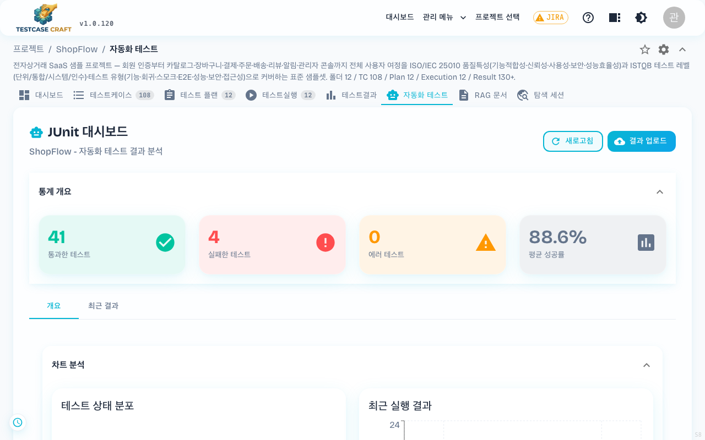
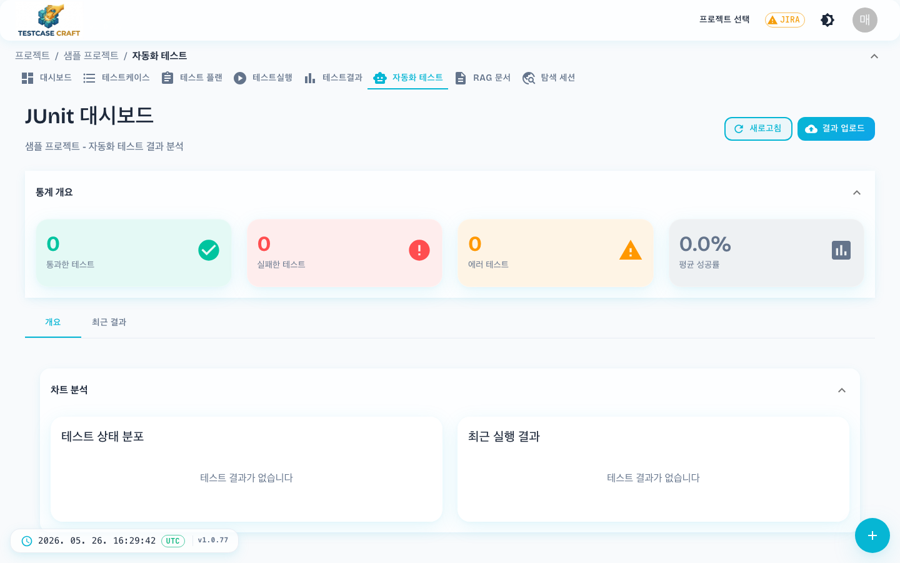
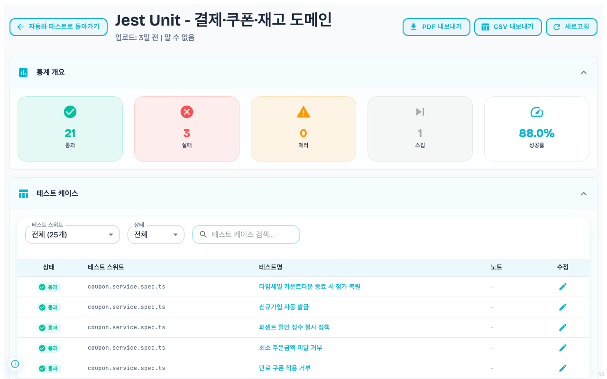

## 11. 자동화 테스트

상단 **[자동화 테스트]** 탭은 자동화 테스트 도구(JUnit·Playwright·Pytest 등)가 만든 결과 파일을 올려서 TestcaseCraft에서 모아 보는 기능입니다.

- **결과 파일 업로드** — JUnit XML 파일(최대 100MB)
- 올리면 자동으로 케이스와 매칭하고 통계에 반영됩니다
- 목록에서 결과 행을 클릭하면 상세 화면으로 진입해 개별 테스트의 성공/실패/건너뜀 내역과 에러 메시지를 확인할 수 있습니다
- 어떤 도구로 어떻게 파일을 만드는지는 운영 담당자에게 문의

> 단순히 결과 파일만 따로 보고 싶다면 **[JUnit 결과]** 화면에서 확인할 수 있습니다.

### 11-1. 결과 상세 화면

머리에 통과·실패·에러·건너뜀 집계와 성공률이 붙고, 아래 목록에서 개별 테스트를 봅니다. 테스트 스위트와 상태로 추려 보거나 이름으로 찾을 수 있고, 실패한 항목은 에러 메시지가 함께 펼쳐집니다. 각 행의 연필 아이콘으로 노트를 남기면 그 기록이 결과에 함께 남습니다. 우상단에서 **PDF·CSV 내보내기** 와 **새로고침** 을 씁니다.

이 화면은 주소가 네 갈래인데 모두 같은 화면입니다.

| 주소 | 언제 쓰이는가 |
|---|---|
| `/projects/{projectId}/automation-results/{testResultId}` | 자동화 테스트 목록에서 행을 클릭할 때 |
| `/projects/{projectId}/junit-results/{testResultId}` | JUnit 결과 화면에서 행을 클릭할 때 |
| `/automation-tests/{testResultId}` | 프로젝트를 주소에 안 쓰는 짧은 별칭 |
| `/junit-results/{testResultId}` | 같은 별칭 |

#### 스텝 타임라인

에이전트가 실행한 케이스는 **Tracelog** 탭에 스텝이 순서대로 놓입니다. 스텝마다 무엇을 하려 했는지, 어떤 동작을 했는지, 무엇을 관찰했는지, 그때 주소가 무엇이었는지가 함께 나옵니다. 위쪽에는 케이스가 적어 둔 기대 결과와 에이전트가 낸 실제 결과가 나란히 놓입니다.

**스텝마다 그때의 화면이 함께 놓입니다.** 미리보기를 누르면 원본 크기로 열립니다. 판정만 보고 원인을 찾기 어려울 때 글과 그림을 한자리에서 보며 어느 단계에서 무엇이 달라졌는지 되짚습니다.

구조가 있는 값(예: 스텝 기록 원문)은 **Execution Properties** 에서 접힌 채로 놓입니다. 펼치면 칸별로 정리해 보여 주고, `원문 보기` 로 바꾸면 들여쓴 원문을 그대로 봅니다.

#### 케이스 첨부 (스크린샷)

개별 테스트를 고르면 오른쪽 상세에 **Tracelog · Test Body · 첨부** 세 탭이 나옵니다. 첨부 탭에는 그 케이스에 붙은 파일이 격자로 놓이고, 이미지는 미리보기가 바로 보입니다. 눌러 크게 보거나 내려받을 수 있습니다.

에이전트가 실행한 회차는 **스텝마다 화면을 남깁니다.** 통과했든 실패했든 남기며, 설명에 `SHOP-123 스텝 2/4` 처럼 몇 번째인지 함께 적힙니다. 어느 단계에서 무엇이 달라졌는지 순서대로 되짚을 수 있습니다. 붙은 파일이 없으면 「이 케이스에 붙은 첨부가 없습니다」 만 나옵니다.

| 무엇 | 규칙 |
|---|---|
| 붙일 수 있는 사람 | 자동화 결과를 올릴 수 있는 권한과 같습니다 |
| 볼 수 있는 사람 | 프로젝트를 볼 수 있으면 내려받을 수 있습니다 |
| 파일 형식 | 이미지(png·jpg·gif·webp), 텍스트(txt·log·json·html), pdf |
| 한 파일 크기 | 20MB 까지 |
| 한 케이스 개수 | 30개까지 |

같은 이름을 다시 올리면 새로 쌓지 않고 이미 있는 첨부를 그대로 씁니다. 내용을 갈려면 지운 뒤 다시 올립니다.
