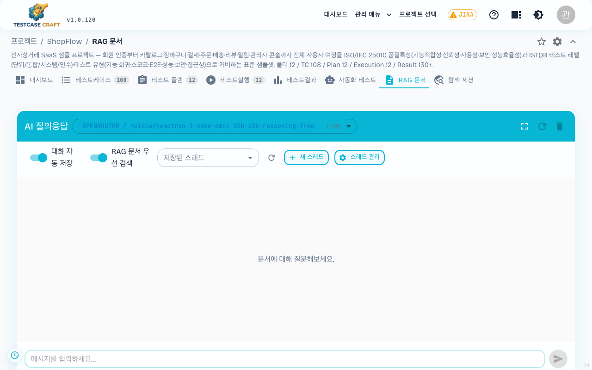

## 12. RAG 문서와 챗

상단 **[RAG 문서]** 탭은 프로젝트 지식 베이스를 관리합니다.

- 문서 업로드 (PDF/MD/HTML/이미지 등) → 자동으로 임베딩 생성
- 케이스 작성 시 "관련 RAG 문서" 자동 추천
- RAG 챗으로 자연어 질의 → 출처 인용 답변

> RAG는 별도의 보조 서비스로 운영됩니다. 일부 운영 환경에서는 비활성화되어 이 탭이 숨겨질 수 있습니다.

**화면 위에 안내가 떠 있다면** 관리자가 기능을 멈춰 둔 것입니다. 장애가 아닙니다. 안내에는 지금 쓸 수 있는 기능과 막힌 기능이 항목별로 나옵니다.

| 안내 | 뜻 |
|---|---|
| 새 자료 등록이 중지되어 있습니다 | 질문·검색·문서 조회는 그대로 됩니다. 새 문서를 올리거나 분석하는 것만 막힙니다 |
| AI 기능이 중지되어 있습니다 | 질문을 포함해 전부 막힙니다 |

두 경우 모두 관리자가 [시스템 설정](17_시스템관리_ADMIN.md#시스템-설정--ai-기능색인-켜고-끄기)에서 다시 켜면 그대로 돌아옵니다.
