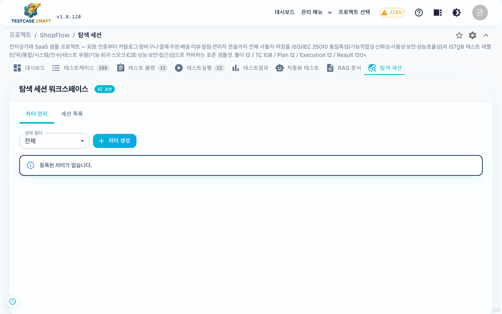

## 13. 탐색 세션 (SBTM)

상단 **[탐색 세션]** 탭은 **Session-Based Test Management** 기반의 탐색 테스트 세션을 관리합니다.

- **차터(Charter)** — 탐색 목표 1줄 정의
- 세션 시작 → 타이머 가동 (보통 60–120분)
- 진행 중 발견 노트/버그/스크린샷 기록
- 종료 시 세션 보고서 자동 작성, 승인 워크플로우

> 환경 변수 `SHOW_EXPLORATORY_SESSION_TAB=true`일 때만 노출됩니다. 설정 방법은 운영자용 문서를 참고하세요 ([20-2. 설치·운영 관련 문서](20_문제해결.md#20-2-설치운영-관련-문서)).
