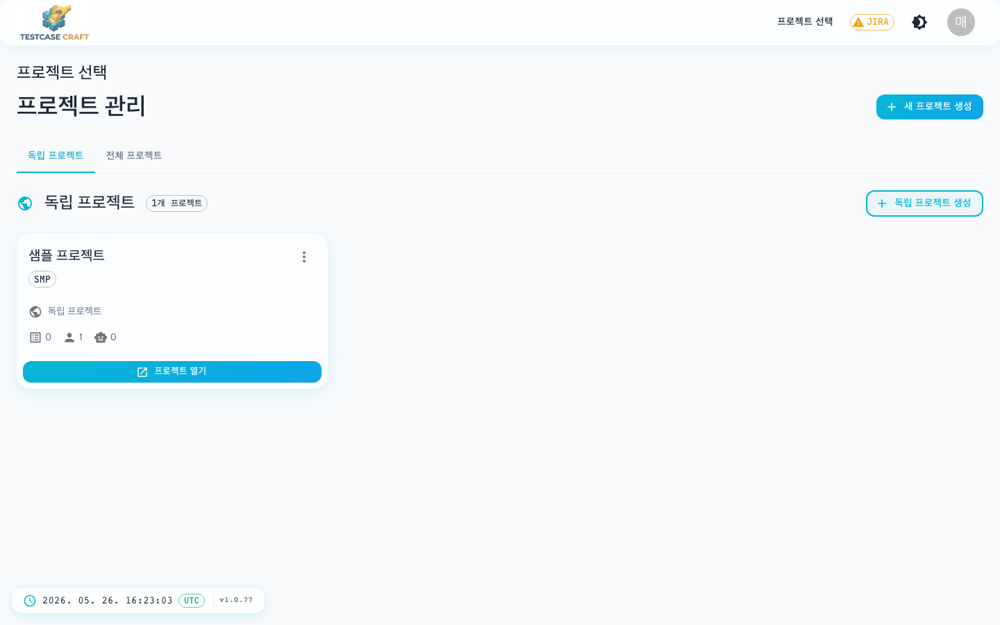
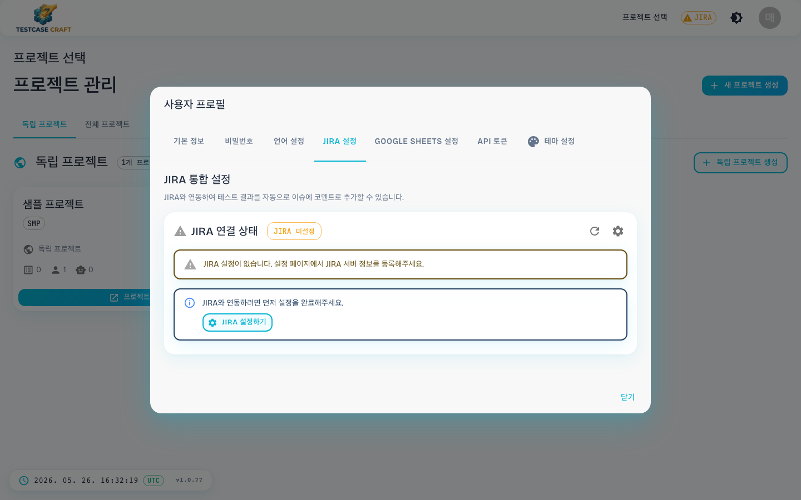
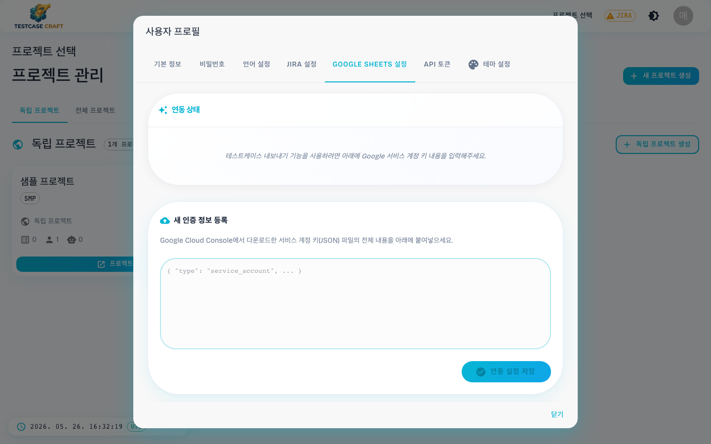
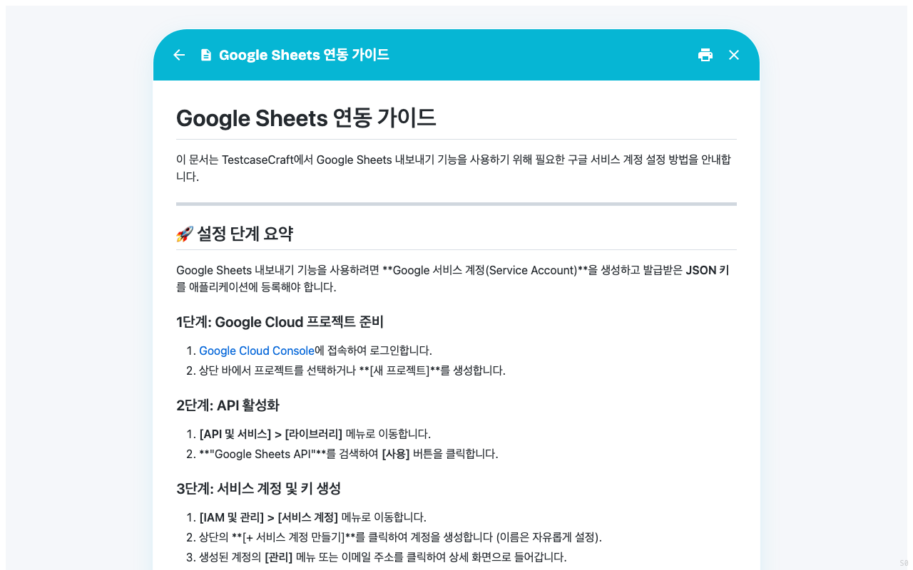
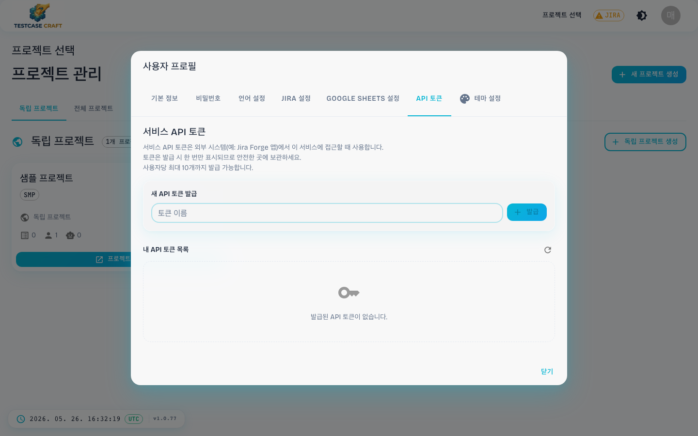

## 14. 외부 연동 (JIRA · Google Sheets · API 토큰)

### 14-1. JIRA 연동

헤더의 **`⚠ JIRA`** 배지는 JIRA 설정이 비어 있다는 경고입니다. 클릭하면 JIRA 연동 설정 화면이 열립니다.

- 서버 URL, 사용자 이메일, API 토큰 입력
- 매핑 필드(우선순위, 담당자 등) 설정
- 저장 후 경고 배지가 사라집니다

### 14-2. JIRA 설정

내 계정에서 사용할 JIRA 주소·이메일·연결 키를 등록합니다. 등록 후 헤더의 **⚠ JIRA** 경고가 사라집니다.

### 14-3. Google Sheets 설정

Google Sheets로 테스트 케이스를 가져오거나 내보내려면 Google 계정 연결이 필요합니다. 화면 안내에 따라 한 번만 연결하면 됩니다.

> 💡 자세한 연결 절차는 앱 안의 가이드 문서에서 단계별 그림과 함께 확인할 수 있습니다. 설정 화면의 안내 링크를 클릭해도 같은 문서가 열립니다. 주소를 직접 입력할 때는 **`.md` 까지 붙여야** 열립니다.

### 14-4. API 토큰

다른 시스템(예: JIRA 부가 앱, 자동화 스크립트)에서 TestcaseCraft에 연결할 때 쓰는 **연결 키(토큰)** 를 발급합니다.

- 한 사람당 **최대 10개** 발급 가능
- **발급한 직후 한 번만 전체 키가 표시되므로 반드시 안전한 곳에 복사** 해 두세요. 다시 볼 수 없습니다.
- 잃어버린 키는 폐기하고 새로 발급해야 합니다
