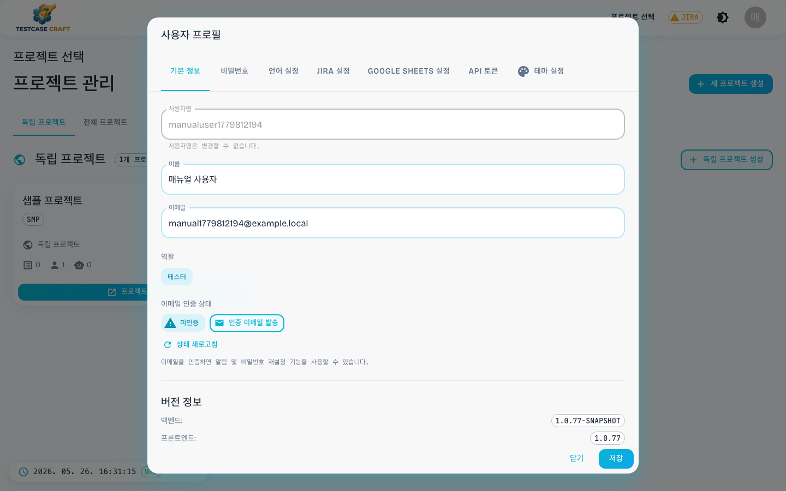
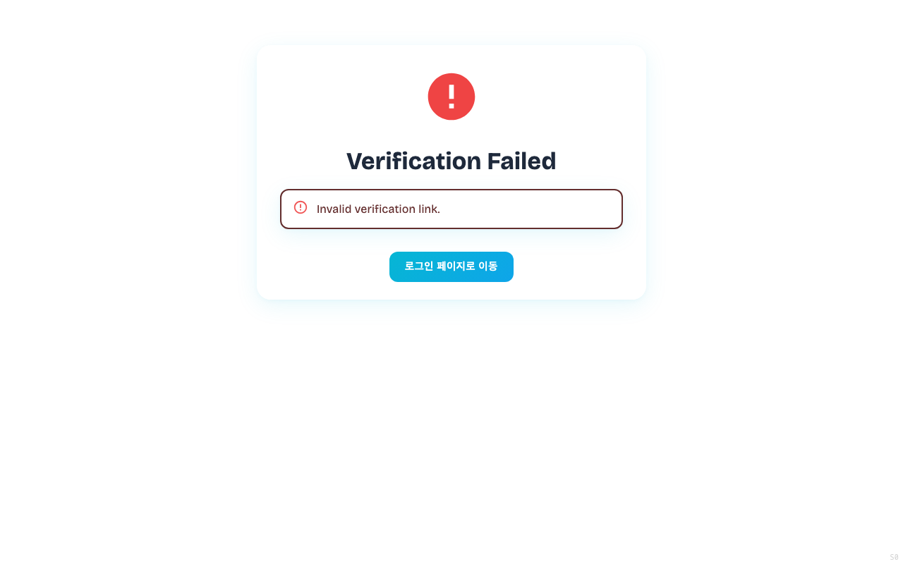
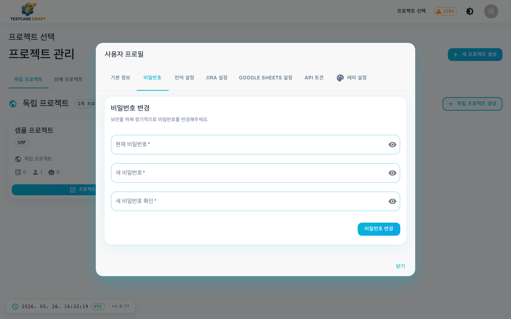
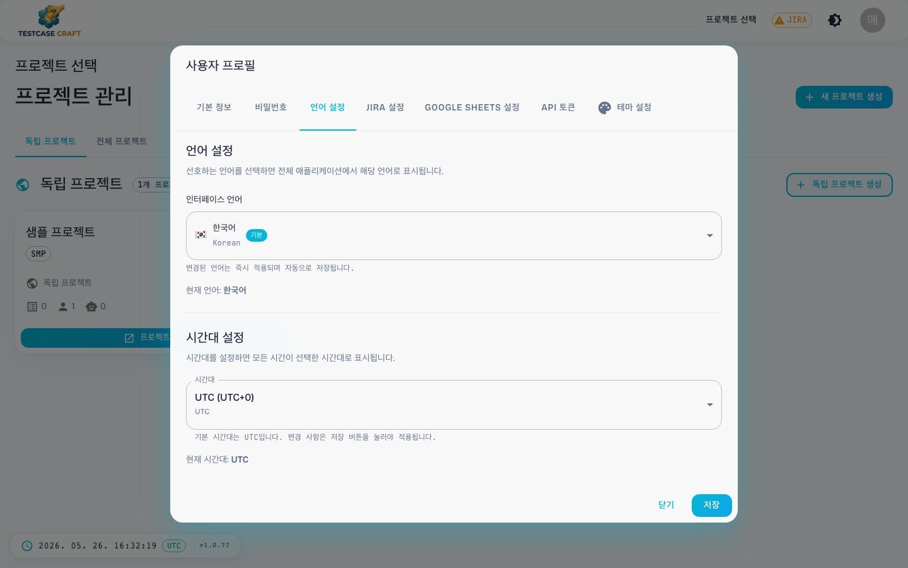
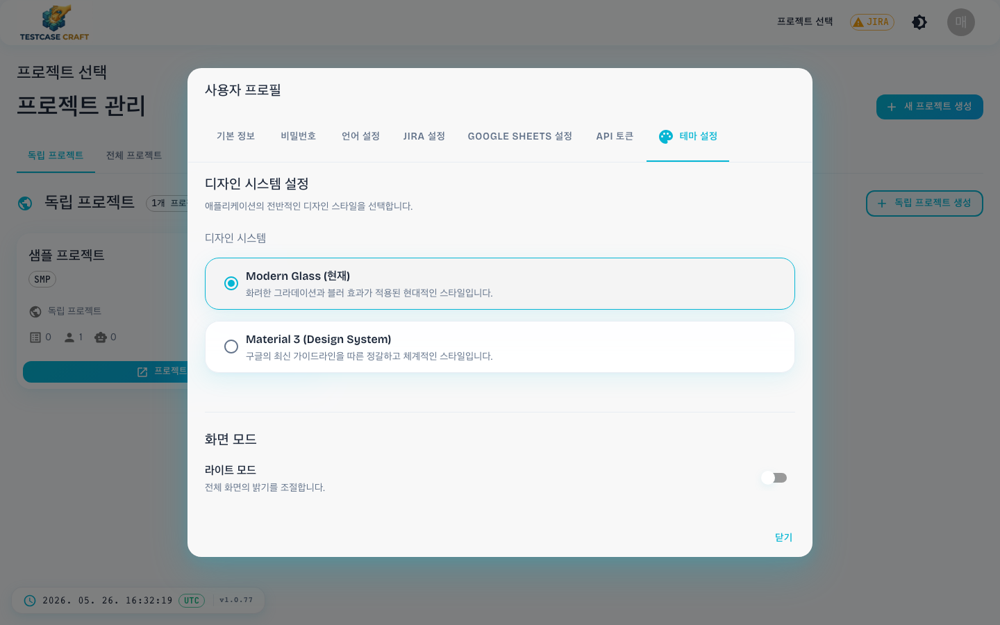

## 15. 내 계정 설정

헤더 우상단 **사용자 아바타** → **[프로필]** 을 클릭하면 사용자 프로필 다이얼로그가 열립니다.
다이얼로그는 7개의 탭으로 구성되어 있습니다.

### 15-1. 기본 정보

- 사용자명 / 이름 / 이메일 표시 (사용자명은 변경 불가)
- 역할 (테스터/PM/관리자 등) 배지
- 이메일 인증 상태 — **[미인증]** 이면 **[인증 이메일 발송]** 버튼으로 메일 인증. 받은 메일의 링크를 열면 인증 결과 화면이 표시됩니다. 인증 후 **[상태 새로고침]** 버튼으로 배지를 갱신하세요.

링크에 담긴 인증 값이 없거나 이미 쓰였으면 위와 같이 실패로 표시됩니다. 이때는 프로필에서 **[인증 이메일 발송]** 을 다시 눌러 새 메일을 받으세요. 성공하면 같은 자리에 완료 안내와 로그인 버튼이 나타납니다.
- 하단에 서비스 버전(서버/화면) 표시

### 15-2. 비밀번호 변경

기존 비밀번호 확인 후 새 비밀번호 + 확인 입력 → **[저장]**.

### 15-3. 언어 & 시간대 설정

- **인터페이스 언어** — 한국어/English 등 (변경 시 즉시 반영, 자동 저장)
- **시간대 설정** — 모든 시간 표시(생성일·이동 로그·테스트 결과 등)에 적용
  - 기본값 `UTC`, 사용자 로컬 시간대로 변경 시 **[저장]** 클릭

### 15-4. 테마 설정

- **화면 모드** — 라이트/다크 모드 선택 (헤더의 ◐ 아이콘과 연동)
- **디자인 시스템** — Glass(유리 질감) / Material 3 두 가지 디자인 스타일 중 선택. 변경 즉시 화면 전체에 반영됩니다.
- **메뉴 구조** (신규) — 두 가지 레이아웃 선택
  - `현재 레이아웃 — 가로 탭`: 지금까지 사용해 온 상단 탭 구조 (기본값)
  - `신규 레이아웃 — 좌측 메뉴`: 좌측에 세로 메뉴를 표시하고, 접기 아이콘으로 아이콘만 남길 수 있습니다
  - 설정 변경은 즉시 반영되며, 서버에 저장되어 다른 PC에서 로그인해도 유지됩니다
  - 신규 레이아웃에서는 테스트 플랜·테스트 실행이 목록과 상세를 2단으로 표시하며, 브레드크럼 첫 자리가 프로젝트 선택기로 변경됩니다
