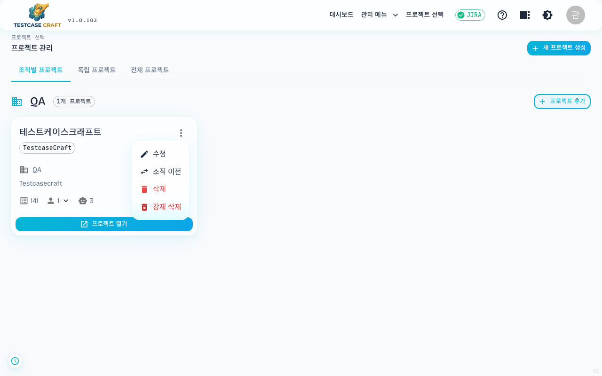
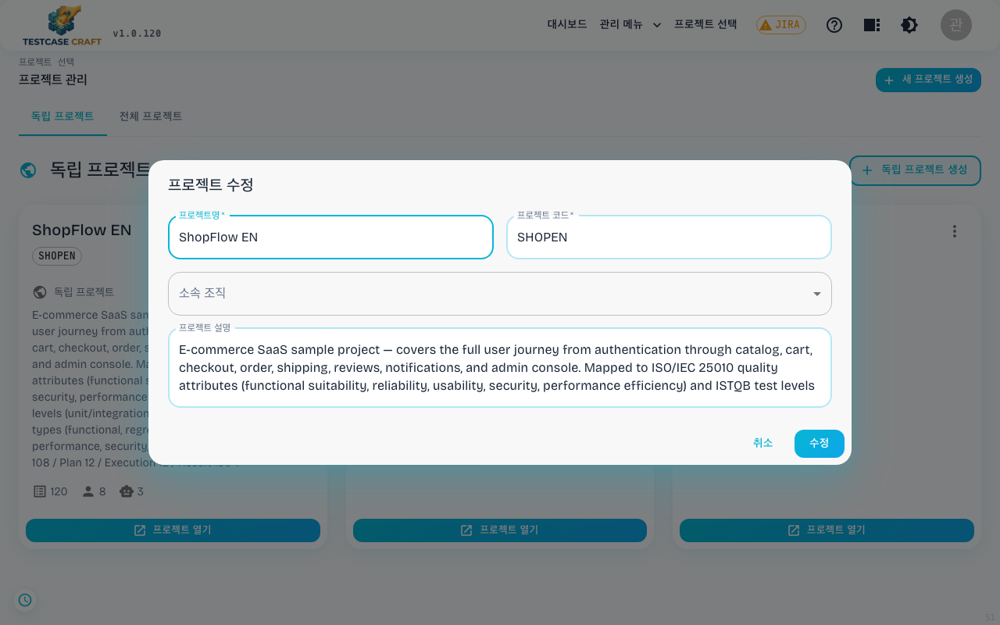

## 16. 프로젝트 설정 (PM)

### 16-1. 프로젝트 설정 화면

프로젝트 화면 상단 우측의 톱니 아이콘을 누르면 **프로젝트 설정**이 열립니다. 일반·멤버·에이전트 연동 세 탭이 있습니다.

| 탭 | 하는 일 | 쓸 수 있는 사람 |
|---|---|---|
| 일반 | 프로젝트 이름·설명·정렬 순서 변경 (코드는 생성 후 못 바꿉니다) | PROJECT_MANAGER, ADMIN |
| 멤버 | 사용자를 검색해 추가, 역할 드롭다운 변경, 멤버 제거 | PROJECT_MANAGER, LEAD_DEVELOPER, ADMIN |
| 에이전트 연동 | 외부 QA 에이전트 연결 ([16-3. 에이전트 연동 (PM)](#16-3-에이전트-연동-pm)). 서버 스위치가 꺼져 있으면 숨습니다 | PROJECT_MANAGER, ADMIN |

사용자 검색 칸에 두 글자 이상 넣으면 사용자명·이름·이메일이 걸리는 사람을 찾아 보여 줍니다. 이미 이 프로젝트의 멤버이거나 비활성 계정인 사람은 목록에 나오지 않으므로, 고른 뒤 추가가 중복으로 실패하지 않습니다. 같은 검색을 조직 관리의 멤버 초대에서도 씁니다.

톱니 아이콘은 위 세 부류에게만 보입니다. 역할 드롭다운은 고르는 즉시 반영되며 저장 버튼이 없습니다. 마지막 남은 PROJECT_MANAGER 의 역할을 낮추거나 제거하는 것은 막혀 있습니다. PROJECT_MANAGER 를 새로 부여하거나 회수하는 일은 현재 PM 과 시스템 ADMIN 만 할 수 있습니다.

### 16-2. 프로젝트 단위 설정 (PM)

프로젝트 카드의 우상단 **⋮ (점 3개)** 메뉴 또는 프로젝트 진입 후 헤더의 메뉴로 접근합니다. (`PROJECT_MANAGER` 권한)

메뉴에는 **수정 · 조직 이전 · 삭제** 가 있습니다. **[수정]** 을 누르면 프로젝트 정보 폼이 열립니다.

이름·코드·소속 조직·설명을 고칩니다. 코드는 케이스의 표시 ID에 쓰이는 값이라(`SHOP-031` 의 `SHOP`) 바꾸면 이후 표시가 함께 달라집니다.

- 프로젝트 이름 / 코드 / 설명 변경
- 멤버 초대 / 역할 부여 (PM / LEAD_DEVELOPER / DEVELOPER / TESTER / CONTRIBUTOR / VIEWER — 6단계, [18. 역할과 권한](18_역할과_권한.md#18-역할과-권한) 참고)
- 시스템 기본 폴더 / 우선순위 / 태그 컨벤션
- 프로젝트 삭제 (모든 케이스·결과 함께 삭제 — 되돌릴 수 없음)

> 신규 프로젝트는 생성한 사용자가 자동으로 **PROJECT_MANAGER** 가 됩니다. VIEWER 또는 TESTER 권한 사용자는 이 메뉴가 보이지 않거나 일부만 활성화됩니다.

### 16-3. 에이전트 연동 (PM)

`/projects/{projectId}/settings` 의 **에이전트 연동** 탭에서 외부 QA 에이전트를 연결합니다. 자연어로 쓴 테스트 케이스를 LLM 에이전트가 읽고 브라우저를 직접 조작해 실행하는 도구이며, 제품 밖에서 따로 도는 별도 앱입니다. 판정과 증거만 테스트실행으로 들어옵니다.

**탭이 보이지 않는 경우** 두 가지입니다. 서버에서 `AGENT_INTEGRATION_ENABLED` 가 꺼져 있거나, 프로젝트 매니저 권한이 없는 경우입니다.

| 항목 | 설명 |
|---|---|
| 에이전트 이름 | 자동화 테스트 화면 버튼에 이 이름이 그대로 나옵니다. |
| 에이전트 주소 | 에이전트 앱 주소. `http` 또는 `https` 로 시작해야 합니다. 서버가 연결을 확인할 때 쓰는 주소입니다. |
| 브라우저용 주소 (선택) | 비워 두면 위 주소를 그대로 씁니다. 서버가 닿는 주소와 브라우저가 닿는 주소가 다를 때만 채웁니다. 실행 버튼이 이 주소를 엽니다. |
| 인증 토큰 | 에이전트 앱이 요구하는 토큰. 비워 두면 기존 값을 유지하고, 저장된 값은 화면에 다시 보이지 않습니다. |
| 기본 프로필 | 에이전트 앱에 등록한 프로필 식별자. 허용 도메인·금지 행동·테스트 계정이 그 안에 있습니다. |
| 이 프로젝트에서 사용 | 꺼 두면 자동화 화면에 에이전트 관련 항목이 나타나지 않습니다. 기본값은 꺼짐입니다. |

**[연결 테스트]** 를 누르면 에이전트의 상태 확인 주소만 호출하고 응답에서 상태와 버전 두 값만 읽습니다. 저장을 먼저 해야 이 버튼이 활성화됩니다.

켜고 연결이 확인되면 **자동화 테스트** 화면 헤더에 `{이름} 실행` 버튼이 생깁니다. 이 버튼은 에이전트 앱을 새 창으로 열 뿐이고, 결과가 제품으로 돌아오는 경로와는 무관합니다. 그래서 버튼이 동작하지 않아도 에이전트 앱에서 직접 실행할 수 있습니다.

**알아 둘 것.** 케이스 하나에 30초에서 1분이 걸리고 비용이 듭니다. 같은 케이스를 다시 돌리면 행동이 조금씩 달라지므로, 재현성이 필요한 회귀에는 JUnit 자동화를 함께 씁니다. 판정은 초안이고 확정은 사람이 합니다. 에이전트가 만든 실행은 이름 앞에 `[AI]` 가 붙고 태그에 `ai-agent` 가 들어가 사람이 진행한 실행과 목록에서 갈립니다. 파일 업로드와 캡차가 들어간 시나리오는 지원하지 않습니다.
