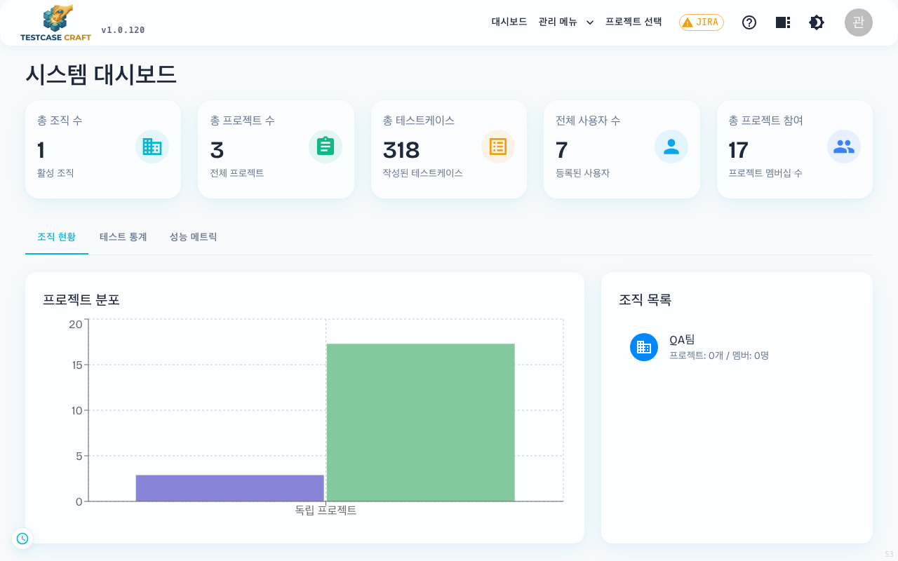
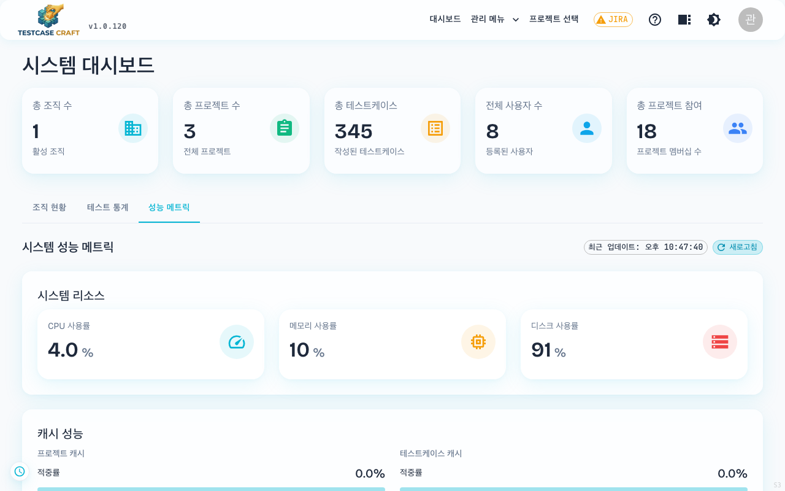
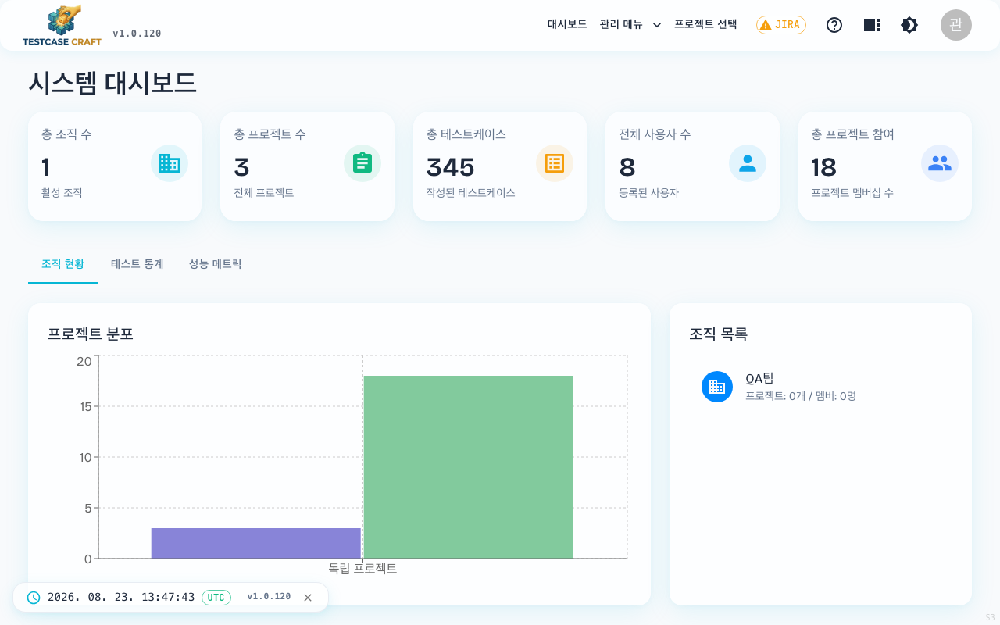
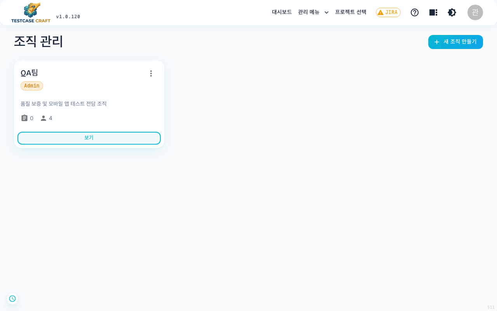
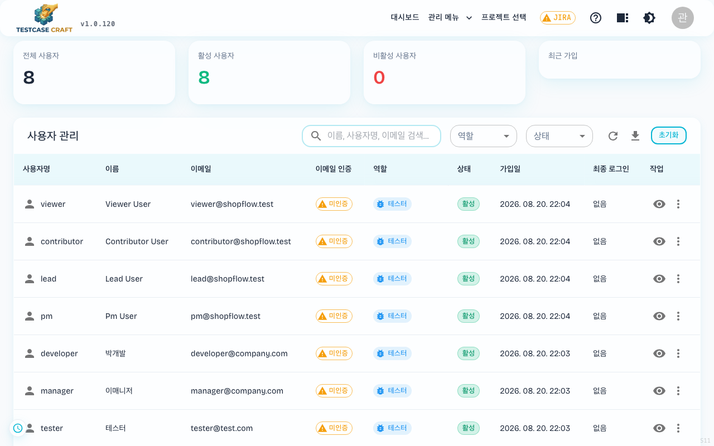
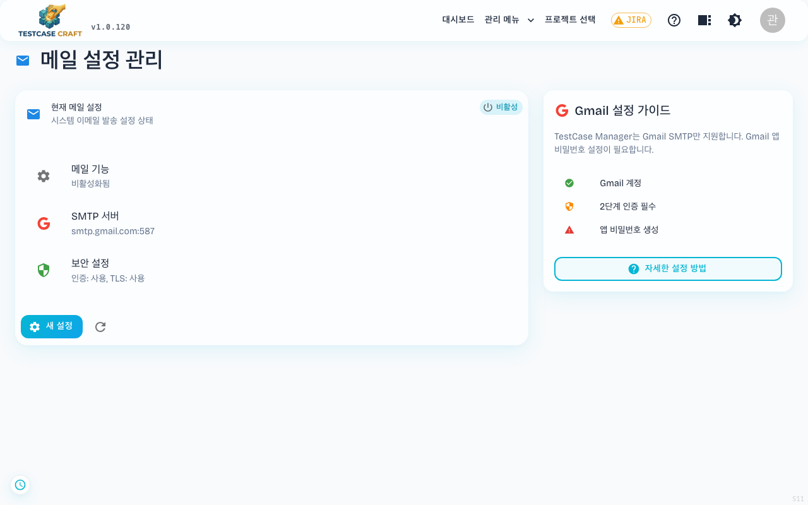
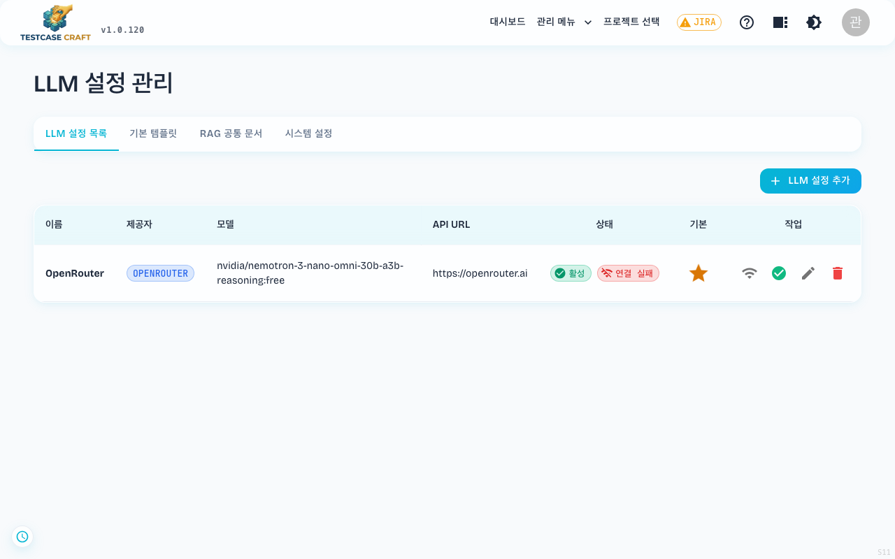
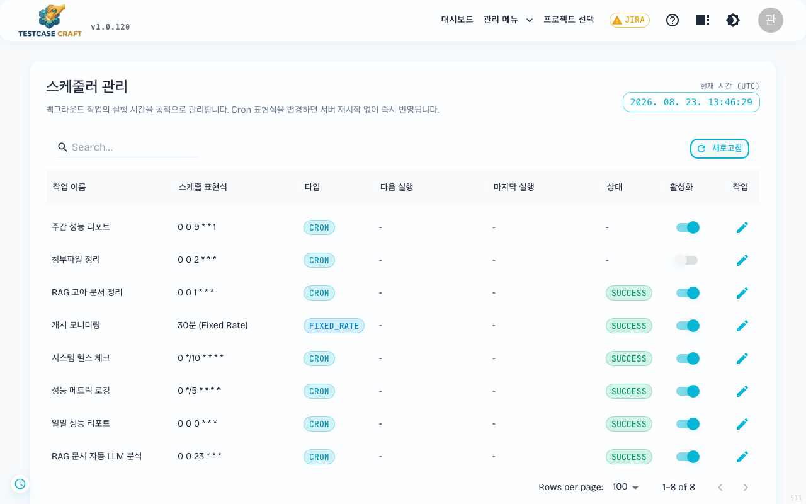
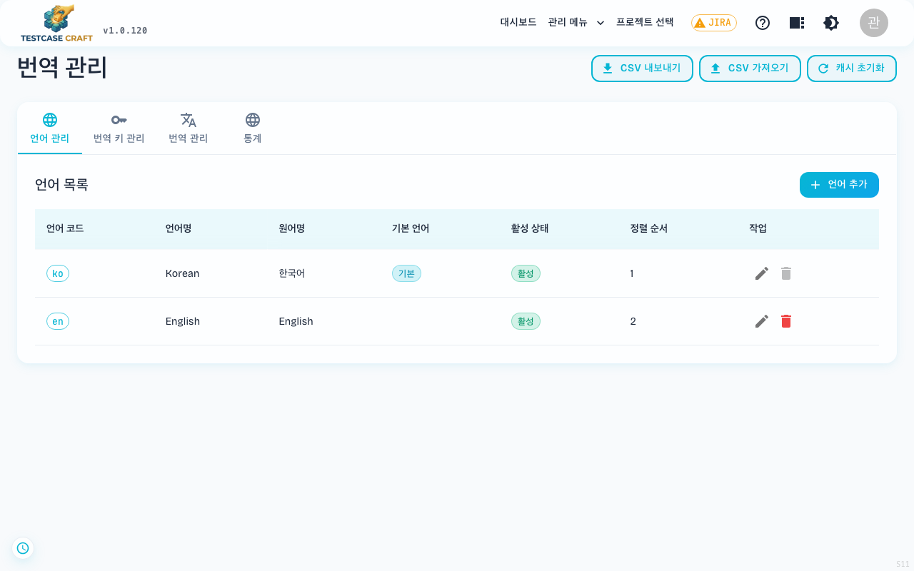

## 17. 시스템 관리자 설정 (ADMIN 전용)

> ⚠️ 본 섹션은 `role=ADMIN` 사용자에게만 노출되는 메뉴입니다. 시스템 기본 admin 계정의 초기 비밀번호는 코드에서 `admin / admin123`으로 정의되어 있으며, 운영 환경 배포 직후 반드시 변경하세요.

### 17-1. 관리자 메뉴 진입

관리자 계정으로 로그인하면 헤더에 **[대시보드] / [관리 메뉴 ▾] / [프로젝트 선택]** 이 추가로 노출됩니다.

드롭다운 항목:
- **조직 관리**
- **사용자 관리**
- **메일 설정**
- **LLM 설정**
- **스케줄러 관리**

### 17-2. 전체 대시보드

헤더 좌측 **[대시보드]** 는 전 조직/전 프로젝트를 가로지르는 운영 통계 화면입니다.

화면 제목은 **시스템 대시보드**이고, 상단에 총 조직 수·총 프로젝트 수·총 테스트케이스·전체 사용자 수·총 프로젝트 참여가 카드로 놓입니다. 그 아래가 탭 세 개입니다.

| 탭 | 내용 |
|---|---|
| 조직 현황 | 조직·프로젝트별 구성과 인원 |
| 테스트 통계 | 전 프로젝트를 합친 결과 분포 |
| 성능 메트릭 | 서버 자원과 캐시 상태 |

**성능 메트릭** 탭은 운영 상태를 숫자로 보여 줍니다.

- **시스템 리소스**: CPU·메모리·디스크 사용률
- **캐시 성능**: 프로젝트 캐시와 테스트케이스 캐시의 적중률(적중·누락 건수 포함). 적중률이 낮으면 같은 조회를 매번 DB 까지 가져오고 있다는 뜻입니다
- **[새로고침]** 으로 그 시점 값을 다시 읽습니다. 자동으로 갱신되지 않으며, 옆의 **최근 업데이트** 시각이 언제 읽은 값인지 알려 줍니다

### 17-3. 서버 시간·버전 확인

ADMIN 으로 로그인하면 화면 **왼쪽 아래에 시계 아이콘**이 고정으로 붙습니다. 기본은 접힌 상태이고, 누르면 서버 시간과 앱 버전이 한 줄로 펼쳐집니다.

- 시간은 **내 프로필의 시간대로 변환해** 보여 주고, 옆의 배지가 어느 시간대인지 알려 줍니다(`UTC`·`KST` 등). 시간대를 설정하지 않았으면 UTC 로 표시됩니다. 결과 기록 시각이 예상과 다를 때 이 배지를 먼저 확인합니다. 시간대 설정은 [15-3. 언어 & 시간대 설정](15_내계정_설정.md#15-3-언어--시간대-설정) 에서 바꿉니다.
- 앱 버전이 함께 나오므로 문의할 때 이 값을 알려 주면 됩니다.
- 펼친 동안 **30초마다** 다시 읽습니다. ✕ 로 접으면 갱신을 멈춥니다.
- **ADMIN 이 아닌 계정에는 아이콘이 보이지 않습니다.**

### 17-4. 조직 관리

`/organizations` — 조직(Organization) 단위로 프로젝트를 그룹핑합니다.

- 조직 신규 생성 / 수정 / 멤버 초대
- 조직 내 그룹(Group) 단위로 권한 매트릭스 관리
- 클릭 시 조직 상세로 진입

### 17-5. 사용자 관리

`/users` — 시스템의 모든 사용자를 조회·관리합니다.

- 통계 카드: 전체 / 활성 / 비활성 / 최근 가입
- 검색: 이름·사용자명·이메일
- 필터: 역할(ADMIN/PM/테스터/일반 사용자) · 상태(활성/비활성)
- 행 우측 액션: **👁 상세 보기 · ⋮ 비밀번호 재설정 / 역할 변경 / 활성·비활성 토글**
- 이메일 인증 상태 배지 (미인증/완료)
- 우상단 **🔄 새로고침 / ⬇ 다운로드 / 초기화** 버튼

### 17-6. 메일 설정

`/mail-settings` — SMTP / 발신자 / 템플릿 설정.

- SMTP 호스트·포트·계정
- 발신자 이메일 / 표시 이름
- 이메일 인증·비밀번호 재설정·실행 결과 알림 등 시스템 메일 템플릿
- **테스트 메일 발송** 으로 설정 검증

### 17-7. LLM 설정

`/llm-config` 는 AI 기능에 쓰는 설정을 모아 둔 화면입니다. 탭은 LLM 설정목록, 기본 템플릿, RAG 공통 문서, 시스템 설정입니다.

| 탭 | 하는 일 |
|---|---|
| LLM 설정목록 | 어떤 AI 서비스를 쓸지 등록하고 연결을 확인합니다 |
| 기본 템플릿 | 케이스를 만들 때 AI에게 주는 기본 형식을 정합니다 |
| RAG 공통 문서 | 모든 프로젝트가 함께 보는 문서를 관리합니다 (17-6-1) |
| 시스템 설정 | AI 기능과 색인을 켜고 끕니다 (17-6-2) |

**LLM 설정목록** 탭에서 등록하는 항목입니다.

- 제공자: OpenAI / OpenRouter / NVIDIA / Perplexity / Ollama / OpenWebUI (Ollama·OpenWebUI 는 서버에 직접 띄우는 모델입니다)
- 모델 이름, API Key, 기본 주소
- 분석용 모델 (선택): 비워 두면 위 모델로 분석합니다
- 등록 후 **[연결 테스트]** 로 값이 맞는지 확인합니다

> **분석용 모델을 따로 지정하는 이유**: AI 는 답을 만들기 전에 질문 의도를 파악하고 조회 결과를 정리합니다. 이 준비 작업은 정해진 형식으로 답하면 되므로 값싸고 빠른 모델로도 충분합니다. 답변에는 좋은 모델을, 준비 작업에는 값싼 모델을 지정하면 응답이 빨라집니다. 비워 두면 답변 모델로 준비 작업까지 처리합니다.

> **연결 테스트에서 「암호화 키가 설정되지 않았습니다」가 나오면** — API Key는 저장하기 전에 암호화하는데, 서버에 그 키가 없는 상태입니다. 화면에 나오는 해결 절차를 펼치면 필요한 명령과 설정 이름을 복사할 수 있습니다. 서버 담당자가 값을 넣고 다시 시작해야 합니다.

#### RAG 공통 문서

프로젝트마다 따로 올리지 않아도 되는 문서를 이 탭에 등록합니다. 모든 프로젝트의 질문에서 함께 검색됩니다.

- 공통 문서 올리기·지우기
- 프로젝트에 올라온 문서를 공통으로 옮기기
- 사용자가 보낸 공통 등록 요청을 승인하거나 반려하기

#### 시스템 설정 — AI 기능·색인 켜고 끄기

「RAG 기능 활성화 상태」와 「벡터 색인」 두 토글이 있고 끄는 범위가 다릅니다.

| 토글 | 끄면 |
|---|---|
| **RAG 기능 활성화 상태** | 질문·검색·문서 조회까지 **전부** 멈춥니다 |
| **벡터 색인** | 새 자료 등록만 멈추고, **이미 등록된 자료로 질문하는 것은 그대로** 됩니다 |

상태별로 쓸 수 있는 기능은 이렇습니다.

| 상태 | 질문·대화 | 문서 검색 | 문서 목록·내려받기 | 문서 등록·분석 | 케이스 색인 |
|---|---|---|---|---|---|
| 둘 다 켜짐 | 가능 | 가능 | 가능 | 가능 | 가능 |
| 색인만 끔 | 가능 | 가능 | 가능 | 불가 | 불가 |
| AI 기능 끔 | 불가 | 불가 | 불가 | 불가 | 불가 |

색인만 끄는 것은 **비용을 묶어 두거나 자료 정리를 잠시 멈추면서 질문은 계속 받고 싶을 때** 씁니다.

끈 상태에서 RAG 화면을 열면 쓸 수 있는 기능과 막힌 기능이 항목별로 나옵니다. 요청이 실패했을 때 장애인지 설정 때문인지 사용자가 구분할 수 있습니다.

**주의할 점이 둘 있습니다.**

- **색인을 끈 동안 추가하거나 수정한 케이스는 검색 결과에 나오지 않습니다.** 다시 켜도 그 사이 변경분을 자동으로 따라잡지 않으므로, 필요하면 문서를 다시 분석해야 합니다.
- **AI 기능을 끄면 관련 예약 작업도 함께 중지됩니다.** 다시 켠 뒤에는 [스케줄러 관리](#17-8-스케줄러-관리) 화면에서 직접 켜야 합니다.

### 17-8. 스케줄러 관리

`/scheduler` — 주기적 백그라운드 작업의 켜고/끄기·주기 변경.

- 등록된 잡 목록 (예: JIRA 동기화, RAG 인덱스 재구축, 만료 토큰 정리)
- 각 잡의 **Cron 표현식**, 마지막 실행 시각/결과
- **수동 실행** 버튼, 일시정지/재개

### 17-9. 번역 관리 (i18n)

`/translation-management` — UI 다국어 키와 번역을 동적으로 편집합니다 (헤더 메뉴에는 기본 비노출 — URL 직접 접근).

- 언어별 번역 키/값 편집
- 누락된 키 통계
- 카테고리별 그룹화
- 추가 언어 등록 가능

> 본 화면은 i18n 키가 많아 일반 사용자에게는 보이지 않습니다. 한국어/영어 외 추가 언어를 도입하거나 라벨을 수정할 때만 사용합니다.
