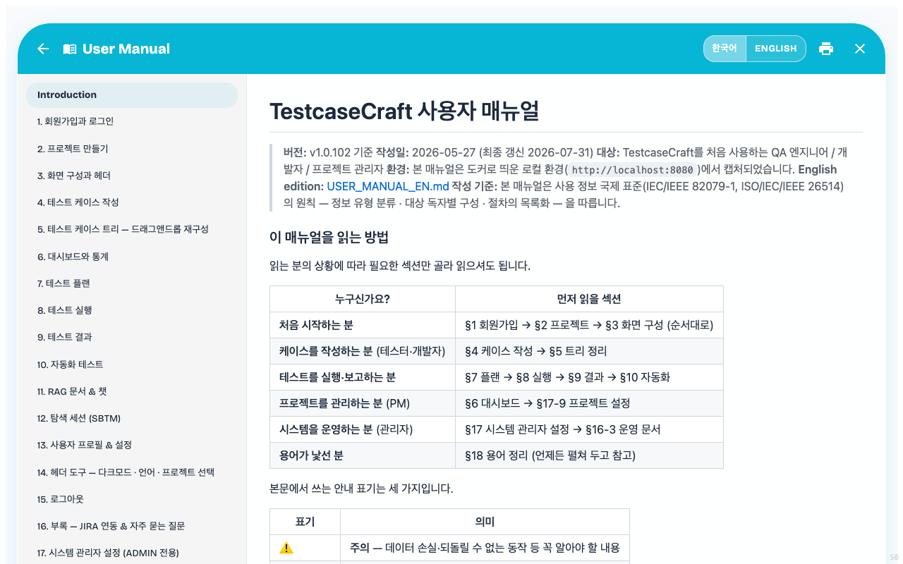

## 20. 문제 해결과 운영 문서

### 20-1. 자주 만나는 화면 이슈

| 증상 | 점검 |
|---|---|
| `⚠ JIRA` 배지가 늘 보임 | 정상 — JIRA 설정 안 했으면 항상 노출. 사용하지 않으면 무시 |
| 헤더에 + 추가 버튼이 안 보임 | 프로젝트 권한이 VIEWER인지 확인 (PM/편집자만 추가 가능) |
| 드래그가 동작 안 함 | 읽기 전용(VIEWER) 권한이거나, 케이스를 **선택하는 화면**(예: 테스트 플랜에 넣을 케이스 고르기)에서는 끌어 놓기가 꺼져 있습니다. 우클릭 메뉴/순서 편집 모드로 대체 가능 |
| 결과 입력 화면을 열어 봤는데 결과가 바뀌어 있음 | v1.0.80 이상에서는 발생하지 않습니다 — 보기만 하면 저장되지 않도록 개선됨 ([9-2. 자동 저장 — 보기만 하면 절대 저장되지 않습니다](09_테스트실행.md#9-2-자동-저장--보기만-하면-절대-저장되지-않습니다) 참고). 과거 버전에서 생긴 빈 미실행 기록은 실제 결과를 입력하면 정리됩니다 |
| 입력 모드에 '고급 스프레드시트'가 안 보임 | 정상 — 현재 임시로 숨겨진 기능입니다. 기본 스프레드시트 모드를 사용하세요 |
| 화면이 계속 로딩 중 | 일시적 네트워크 오류 가능 — 새로고침 후에도 계속되면 운영 담당자에게 문의 |
| `🚨 요청 제한 초과` 창이 뜸 | 같은 IP 에서 **1초에 60번**을 넘겨 요청했습니다. 창의 남은 시간이 0 이 되면 풀리고, **[지금 재시도]** 로 바로 다시 시도합니다. 새로고침을 연달아 누르거나 여러 탭이 같은 화면을 동시에 폴링할 때 나옵니다. 회사망처럼 여러 사람이 한 IP 를 공유하면 합산되니, 반복되면 운영 담당자에게 알립니다 |
| 회원가입에서 `Failed to fetch` | 서버 측 환경 변수 문제일 가능성 — 운영 담당자에게 문의. 상세는 [`../../deployment/DOCKER_SETUP.md`](../../deployment/DOCKER_SETUP.md) 10-2절 |

### 20-2. 설치·운영 관련 문서

자체 호스팅·도커 설정·환경 변수·백업·업그레이드·트러블슈팅 등 **운영자용 가이드**는 별도 문서로 분리되어 있습니다.

👉 **[`docs/deployment/DOCKER_SETUP.md`](../../deployment/DOCKER_SETUP.md)**

**앱 안에서 이 매뉴얼 보기** — 헤더의 **?** 아이콘 또는 주소 `/manual` 로 열립니다. 로그인 없이도 볼 수 있습니다.

왼쪽 목차에서 절을 골라 이동하고, 우상단 **한국어 / ENGLISH** 로 언어를 바꿉니다. 프린터 아이콘으로 인쇄하거나 PDF로 저장할 수 있습니다. `/manual?l=en` 처럼 주소에 언어를 붙여 링크를 공유해도 됩니다.
